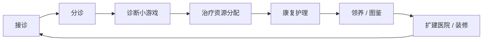
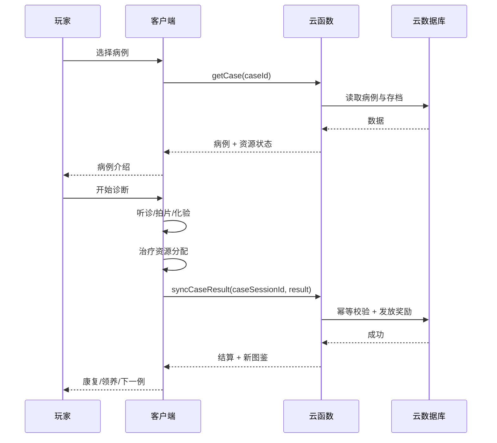

# 03-核心循环与单局流程

| 项目 | 内容 |
|---|---|
| 版本 | v1.0 |
| 日期 | 2026-10-29 |
| 负责人 | 策划 |
| 状态 | 规划态 |
| 依赖文件 | 00-项目总览与执行边界.md、02-产品定位与MVP边界.md |

> **说明**：本文定义单局流程、页面栈、状态流转、时长、决策点、失败兜底、结算与埋点。所有接口与状态名为建议，落地时以实际工程为准。

## 1. 目标与范围

- 把“接诊 → 分诊 → 诊断 → 治疗 → 康复 → 领养/图鉴 → 结算”拆成客户端可直接搭建的页面与状态。
- 明确每阶段目标时长、玩家决策点、失败路径与奖励规则。
- 输出单局埋点表，供数据与商业化使用。

不包含：具体诊断小游戏操作（见 04）、资源数值细节（见 05）、领养规则（见 06）、长线数值（见 07）。

### 1.1 输入依赖

- 00 总纲：目标时长、指标、MVP 范围。
- 02 边界：MVP 必做项与首局情绪脚本。
- 缺失时：若 02 的 MVP 清单未冻结，本文的状态表只作草案，不进入开发。

## 2. 核心循环



- **单局**：一例宠物从接诊到结算，3-5 分钟。
- **长线**：图鉴、好感度、医院扩建、医生团队、季节活动。
- **社交**：好友助力、领养分享、医院参观。

## 3. 页面栈与状态流转

### 3.1 页面栈

```text
Boot → Login → Lobby → CaseIntro → Diagnosis → Treatment → Recovery → Adoption → Result → Lobby
```

- `Login` 失败进入 `Offline`，恢复后回 `Lobby`。
- `Adoption` 是可选的：没有领养资格/领养位时，可从 `Recovery` 直接到 `Result`。
- `Lobby` 可直接打开 `Adoption` 查看已有图鉴，返回 `Lobby`。
- `Result` 可以回到 `Lobby`，也可以直接进入下一例 `CaseIntro`。

### 3.2 状态流转表

| 当前状态 | 事件 | 下一状态 | 条件 | 备注 |
|---|---|---|---|---|
| Boot | 初始化完成 | Login | SDK/云开发/配置加载完成 | 失败进入重试页 |
| Login | 登录成功 | Lobby | 会话有效 | 失败进入 Offline |
| Lobby | 选择病例 | CaseIntro | 病例已解锁 | 未解锁提示条件 |
| Lobby | 打开图鉴 | Adoption | 已解锁领养 | 仅查看，不进入结算 |
| CaseIntro | 开始诊断 | Diagnosis | 资源足够 | 资源不足给出免费路径 |
| Diagnosis | 诊断成功 | Treatment | 星级 ≥1 | 结算诊断结果 |
| Diagnosis | 诊断失败 | Diagnosis | 选择重试 | 免费重试 1 次，之后广告/道具 |
| Diagnosis | 放弃 | Result | 用户确认 | 记为失败，无奖励 |
| Treatment | 治疗成功 | Recovery | 治疗评分达标 | 进入康复 |
| Treatment | 治疗失败 | Treatment | 选择重试 | 广告/好友助力/道具兜底 |
| Treatment | 放弃 | Result | 用户确认 | 记为失败，无奖励 |
| Recovery | 领养 | Adoption | 满足领养条件 | 条件不足显示缺口 |
| Recovery | 跳过领养 | Result | 用户确认 | 宠物留在医院，可稍后领养；不获得图鉴卡 |
| Adoption | 领养完成 | Result | 领养成功 | 发放图鉴卡；证书为可选付费纪念品 |
| Adoption | 返回 | Result | 用户取消 | 不消耗资源 |
| Adoption | 从大厅返回 | Lobby | 仅查看图鉴 | 不触发结算 |
| Result | 下一例 | CaseIntro | 有下一例 | 推荐下一例 |
| Result | 回大厅 | Lobby | 无 | 默认 |
| 任意 | 退出 | Lobby | 二次确认 | 清理临时状态，防重复结算 |

**状态机硬规则：**

- 只允许白名单跳转，禁止从 `Result` 回跳到 `Treatment`。
- 进入 `Result` 前必须做一次幂等结算，`caseSessionId` 唯一。
- 退出单局必须清理计时器、动画、事件监听与临时对象。

## 4. 单局时序



## 5. 阶段目标时长

| 阶段 | 目标时长 | 最短 | 最长 | 说明 |
|---|---|---|---|---|
| 病例介绍 | 10-20 秒 | 8 秒 | 25 秒 | 一句话故事 + 症状 + 目标 |
| 诊断 | 60-120 秒 | 45 秒 | 150 秒 | 1-2 个小游戏 |
| 治疗分配 | 30-60 秒 | 20 秒 | 75 秒 | 3-5 个决策点 |
| 康复 | 15-30 秒 | 10 秒 | 40 秒 | 宠物反馈 + 好感度 |
| 领养/分享 | 15-30 秒 | 0 秒 | 45 秒 | 可选，不强制 |
| 结算 | 10-20 秒 | 8 秒 | 25 秒 | 星级、奖励、下一例 |
| **合计** | **3-5 分钟** | **约 2 分钟** | **约 6 分钟** | 超过 6 分钟需复盘 |

## 6. 玩家决策点

| 阶段 | 决策点 | 玩家选择 | 设计目的 |
|---|---|---|---|
| 病例介绍 | 是否接诊 | 接诊/换一例 | 给玩家选择权，但换例有次数限制 |
| 分诊 | 先治谁 | 普通/紧急/危重 | 轻策略与优先级 |
| 诊断 | 查哪里 | 点击/拖拽/连线 | 参与感与能力感 |
| 治疗 | 用什么药 | 对症/保守/冒险 | 资源取舍 |
| 治疗 | 是否占床位 | 住院/门诊 | 床位管理 |
| 治疗 | 是否加速 | 等待/广告/好友 | 变现与社交 |
| 康复 | 是否领养 | 领养/稍后 | 情感目标 |
| 领养 | 是否分享 | 分享/广告/金币/等待 | 社交裂变与免费替代 |

## 7. 失败、重试与兜底

| 失败点 | 免费路径 | 广告路径 | 社交路径 | 付费路径 |
|---|---|---|---|---|
| 诊断失败 | 免费重试 1 次 | 看广告获得 1 条线索/重试 | 好友助力获得提示 | 道具跳过（金币/内购） |
| 治疗失败 | 免费重试 1 次 | 看广告获得应急药品 | 好友助力获得药品 | 金币/内购补药 |
| 床位不足 | 等待/门诊 | 看广告临时加床 | 好友助力腾床 | 金币扩建（非付费） |
| 康复太慢 | 等待 | 看广告加速 50% | 好友助力加速 | 月卡/加速券 |
| 领养位不足 | 等待/活动 | 看广告临时领养位 | 分享获得爱心 | 金币/等级扩建（非付费） |

**硬规则：** 任何失败点都必须有至少一条免费路径；不得出现“资源不足只能付费”的死锁。

## 8. 结算评分与奖励

### 8.1 评分公式（建议）

```text
score = baseScore
      + accuracyBonus      // 诊断/治疗正确率
      + timeBonus          // 用时低于目标
      + careBonus          // 好感度/护理
      - mistakePenalty     // 误诊/误操作
      - delayPenalty       // 超时/延误
```

### 8.2 星级

| 星级 | 条件 | 金币 | 爱心 | 好感度 | 图鉴碎片 |
|---|---|---|---|---|---|
| 3 星 | 全对 + 用时 <70% + 误诊 0 | 100% | 100% | +3 | 1 |
| 2 星 | 全对 + 误诊 ≤1 | 80% | 80% | +2 | 1 |
| 1 星 | 完成但误诊 ≥2 | 50% | 50% | +1 | 0 |
| 失败 | 超时/误诊过多/放弃 | 0 | 0 | 0 | 0 |

**首通奖励：** 首次通关额外 +50% 金币 + 图鉴碎片 ×2；图鉴卡只能通过领养获得（见 06），重复病例奖励递减，防止刷取。

## 9. 单局埋点事件表

| 事件 | 触发 | 关键属性 | 用途 |
|---|---|---|---|
| `case_start` | 进入病例 | caseId、difficulty、source | 漏斗起点 |
| `case_intro_view` | 病例介绍展示 | caseId、duration | 介绍是否过长 |
| `diagnosis_start` | 开始诊断 | caseId、type | 诊断漏斗 |
| `diagnosis_action` | 每次操作 | type、action、result、time | 操作难度分析 |
| `diagnosis_result` | 诊断结算 | type、stars、mistakes、duration、retryCount | 诊断留存/难度 |
| `treatment_start` | 进入治疗 | caseId、resources | 资源分析 |
| `treatment_allocate` | 分配资源 | medicine、bed、time、result | 决策分析 |
| `treatment_result` | 治疗结算 | success、score、duration | 治疗漏斗 |
| `recovery_start` | 进入康复 | caseId、affection | 情绪反馈 |
| `adoption_view` | 打开领养 | petId、conditions | 领养漏斗 |
| `adoption_share_click` | 点击分享 | petId、channel | 分享率 |
| `assist_received` | 收到助力 | friendId、reward | 助力率 |
| `case_result` | 单局结算 | caseId、stars、coins、hearts、shard、duration | 核心产出 |
| `next_case_click` | 点击下一例 | caseId、source | 连续性 |

## 10. 执行任务清单

| 编号 | 任务 | 负责 | 产出 | 截止 |
|---|---|---|---|---|
| F1 | 页面栈与状态表评审 | 策划 + 客户端 | 状态表 | W2 |
| F2 | 单局原型搭建（占位表现） | 客户端 | 可运行原型 | W2 |
| F3 | 失败兜底矩阵用例 | 策划 | 用例清单 | W3 |
| F4 | 结算评分与幂等联调 | 客户端 + 服务端 | 联调记录 | W4 |
| F5 | 埋点表与看板 | 数据 | 埋点表 | W4 |
| F6 | 12-15 病例时长验收 | 策划 + QA | 验收记录 | W5 |

## 11. 产出物

- 页面栈与状态流转表（本文第 3 节）。
- 单局时序图与阶段时长表（第 4、5 节）。
- 失败兜底矩阵（第 7 节）。
- 评分/奖励表（第 8 节）。
- 埋点事件表（第 9 节）。

## 12. 验收标准

- 客户端能按页面栈与状态表搭出可运行原型。
- 策划能用 12-15 个病例验证 3-5 分钟闭环。
- 每个失败点都有免费/广告/社交/付费四条路径中的至少两条。
- 结算幂等：同一 `caseSessionId` 不会重复发奖。
- 退出/重进不会卡在中间状态。

## 13. 风险与待验证假设

1. **流程过长**：如果诊断+治疗超过 5 分钟，IAA 用户会流失；需用首局数据验证。
2. **决策点过多**：超过 5 个决策点会变成“工作”而不是“游戏”。
3. **广告打断**：失败即弹广告会伤害治愈感；广告必须是可选加速。
4. **状态泄漏**：退出重进导致重复结算/资源复制；必须服务端幂等。
5. **领养强制**：如果跳过领养会损失大量奖励，用户会觉得被强迫；领养应是情感选择。
