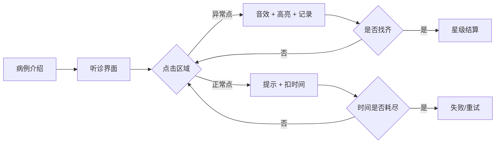
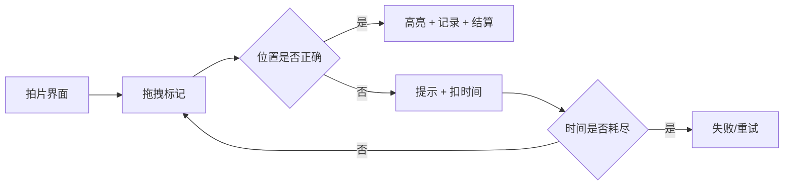
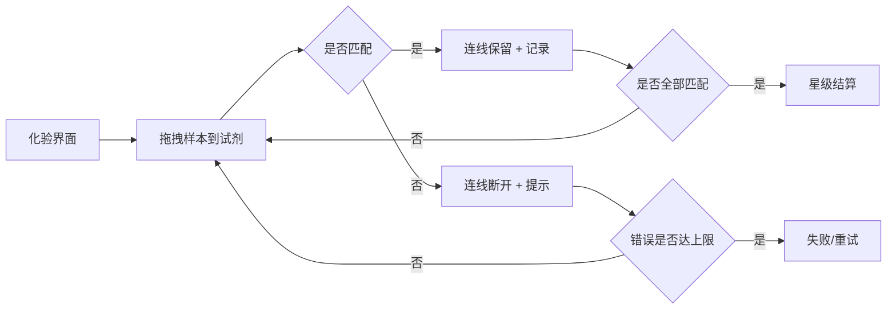

# 04-诊断小游戏系统

| 项目 | 内容 |
|---|---|
| 版本 | v1.0 |
| 日期 | 2026-10-29 |
| 负责人 | 策划+客户端 |
| 状态 | 规划态 |
| 依赖文件 | 03-核心循环与单局流程.md |

> **说明**：本文设计听诊、拍片、化验三个轻量诊断小游戏。所有判定逻辑为建议伪代码，落地时以实际工程为准；不做真实医学影像，不提供真实诊疗建议。

## 1. 目标与范围

- 用点击、拖拽、简单连线三种操作，做出 20-40 秒可完成的诊断小游戏。
- 每个小游戏有明确的成功/失败反馈、1-3 星判定、失败兜底与埋点。
- 一局病例最多组合 2 个诊断小游戏，避免疲劳。

不包含：治疗资源分配（见 05）、病例内容表（见 07/10）、真实医学知识库。

### 1.1 输入依赖

- 03 单局流程：诊断阶段时长、失败兜底与埋点约定。
- 10 配置表：病例的 `diagnosisTypes`、异常点与难度字段。
- 缺失时：若病例配置未定，先用 3 个占位病例验证操作手感，不扩小游戏类型。

## 2. 设计原则

1. **轻操作**：只做点击找病灶、拖拽配药/比对、简单连线；不做三消、重度解谜、长教程。
2. **短时长**：单个 20-40 秒；一局最多 2 个；首局第一个操作 10 秒内必须成功。
3. **明确反馈**：正确有音效/高亮，错误有提示；失败不羞辱玩家。
4. **三条后路**：重试、看广告获得线索、消耗道具跳过；不得只能付费。
5. **虚构医疗**：卡通化表现，不做真实 X 光/化验解读；游戏内注明“虚构医疗模拟”。

## 3. 听诊（点击找病灶）

### 3.1 操作方式

- 屏幕中央是宠物身体（猫/狗/兔），身体上有 4-8 个可点击区域。
- 其中 2-4 个是异常点；玩家点击寻找异常心音/呼吸音。
- 正确：播放心跳/呼吸音效 + 高亮 + 病历打勾。
- 错误：轻微震动 + 提示“这里没有明显异常”，扣时间/增加误诊值。

### 3.2 UI 流程



### 3.3 判定伪代码（建议）

```text
startAuscultation(caseData):
  spots = caseData.abnormalSpots          // 2-4 个异常点
  found = []
  mistakes = 0
  timeLeft = 30s

  onTap(spot):
    if spot in found:
      return
    if spot in spots:
      found.add(spot)
      playHeartbeat(spot)
      showHint("发现异常")
    else:
      mistakes += 1
      timeLeft -= 3s
      showHint("这里没有明显异常")

  if found.size == spots.size:
    return score(timeLeft, mistakes)      // 1-3 星
  if timeLeft <= 0:
    return fail("再试一次")
```

### 3.4 难度曲线

| 难度 | 异常点 | 干扰点 | 时间 | 解锁 |
|---|---|---|---|---|
| 1 | 2 | 2 | 30 秒 | 第 1 天 |
| 2 | 3 | 4 | 28 秒 | 第 3 天 |
| 3 | 4 | 6 | 25 秒 | 第 7 天 |

### 3.5 反馈文案

| 情况 | 文案 |
|---|---|
| 正确 | “找到了，这里的心音不对。” |
| 错误 | “这里没有明显异常，再听听别处。” |
| 时间不足 | “别急，可以重试，或看广告获得一条线索。” |
| 全部找到 | “诊断明确，准备治疗。” |

### 3.6 失败后三条路径

1. **重试**：免费 1 次；之后每次重试需要等待/广告。
2. **广告线索**：看激励视频，高亮一个异常点 3 秒。
3. **道具跳过**：消耗“听诊器电池”直接完成，但星级降为 1 星。

### 3.7 埋点

`diagnosis_start(type=auscultation)`、`diagnosis_action(spot, result)`、`diagnosis_result(stars, mistakes, duration, retryCount)`。

### 3.8 验收

- 20-40 秒可完成；首局第一个异常点 10 秒内可发现。
- 1-3 星判定明确；错误提示不打击人。
- 免费重试、广告线索、道具跳过三条路可用。

## 4. 拍片（拖拽/比对）

### 4.1 操作方式

- 给出一张卡通 X 光片，玩家拖拽放大镜/标记框到异常位置。
- 或者把两张片子拖到对比区，找出骨折/异物。
- 正确：标记框吸附 + 高亮 + 病历记录。
- 错误：提示“再对比一下左右两侧”，扣时间。

### 4.2 UI 流程



### 4.3 判定伪代码（建议）

```text
startXray(caseData):
  target = caseData.lesionArea            // 建议用圆形/矩形区域
  marker = spawnMarker()
  timeLeft = 25s

  onDragEnd(marker):
    if distance(marker, target) <= tolerance:
      return score(timeLeft, 0)
    else:
      showHint("再对比一下左右两侧")
      timeLeft -= 5s

  if timeLeft <= 0:
    return fail("可以看广告获得一次提示")
```

### 4.4 难度曲线

| 难度 | 病灶数量 | 容差 | 时间 | 干扰 |
|---|---|---|---|---|
| 1 | 1 | 大 | 30 秒 | 无 |
| 2 | 1 | 中 | 25 秒 | 1 个相似阴影 |
| 3 | 2 | 小 | 22 秒 | 2 个相似阴影 |

### 4.5 反馈文案

| 情况 | 文案 |
|---|---|
| 正确 | “就是这里，片子对上了。” |
| 错误 | “再看一下边缘，左右对比会更清楚。” |
| 超时 | “时间到了，可以重试或看广告获得提示。” |

### 4.6 失败后三条路径

1. **重试**：免费 1 次。
2. **广告提示**：显示一个半透明圆圈，缩小搜索范围 3 秒。
3. **道具跳过**：消耗“X 光片”直接完成，星级降为 1 星。

### 4.7 埋点

`diagnosis_start(type=xray)`、`diagnosis_action(position, result)`、`diagnosis_result(stars, mistakes, duration, retryCount)`。

### 4.8 验收

- 拖拽手感顺滑，标记框不漂移。
- 容差合理：不因 2-3 像素误差判错。
- 卡通化 X 光片，不做真实医学影像。

## 5. 化验（简单连线/匹配）

### 5.1 操作方式

- 左侧是样本（血液/尿液/皮肤刮片），右侧是试剂/指标。
- 玩家把样本拖到正确试剂，或把颜色/数值连到对应结论。
- 正确：连线保留 + 颜色高亮 + 病历记录。
- 错误：连线断开 + 提示“这个试剂不匹配”。

### 5.2 UI 流程



### 5.3 判定伪代码（建议）

```text
startLab(caseData):
  pairs = caseData.sampleReagentPairs     // 3-4 对
  matched = []
  mistakes = 0

  onConnect(sample, reagent):
    if pair(sample, reagent) in pairs:
      matched.add(pair)
      playSuccess()
    else:
      mistakes += 1
      showHint("这个试剂不匹配")

  if matched.size == pairs.size:
    return score(0, mistakes)
  if mistakes >= 3:
    return fail("再试一次")
```

### 5.4 难度曲线

| 难度 | 配对数 | 干扰项 | 错误上限 | 时间 |
|---|---|---|---|---|
| 1 | 2 | 0 | 3 | 35 秒 |
| 2 | 3 | 1 | 3 | 30 秒 |
| 3 | 4 | 2 | 2 | 28 秒 |

### 5.5 反馈文案

| 情况 | 文案 |
|---|---|
| 正确 | “匹配上了，指标很清楚。” |
| 错误 | “这个试剂不匹配，再看看颜色。” |
| 失败 | “别急，可以重试或看广告获得提示。” |

### 5.6 失败后三条路径

1. **重试**：免费 1 次。
2. **广告提示**：自动匹配一对。
3. **道具跳过**：消耗“化验试纸”直接完成，星级降为 1 星。

### 5.7 埋点

`diagnosis_start(type=lab)`、`diagnosis_action(sample, reagent, result)`、`diagnosis_result(stars, mistakes, duration, retryCount)`。

### 5.8 验收

- 连线/拖拽命中判定清晰，不出现“明明对了却判错”。
- 错误上限与时间合理，不因一次失误直接失败。
- 颜色/形状区分对色弱用户友好，不能只靠颜色。

## 6. 病例组合规则

| 病例难度 | 诊断组合 | 说明 |
|---|---|---|
| 1 | 听诊 或 化验 | 首局只用一个，降低门槛 |
| 2 | 听诊 + 化验 | 两个短小游戏，总时长 60-90 秒 |
| 3 | 拍片 + 化验 | 需要对比与匹配 |
| 4 | 听诊 + 拍片 | 需要定位与判断 |
| 5 | 听诊 + 拍片 + 化验（仅特殊病例） | 不超过 2 个，特殊活动可 3 个 |

**硬规则：** 常规病例最多 2 个诊断小游戏；特殊活动可 3 个，但必须给额外奖励。

## 7. 星级判定

| 星级 | 条件 | 奖励 |
|---|---|---|
| 3 星 | 全对 + 用时 <70% + 误诊 0 | 全额 + 图鉴碎片 |
| 2 星 | 全对 + 误诊 ≤1 | 80% + 好感度 |
| 1 星 | 完成但误诊 ≥2 / 使用跳过道具 | 50% |
| 失败 | 超时/误诊过多 | 无，可重试 |

## 8. 执行任务清单

| 编号 | 任务 | 负责 | 产出 | 截止 |
|---|---|---|---|---|
| K1 | 听诊原型与判定 | 客户端 | 可玩 Demo | W2 |
| K2 | 拍片原型与拖拽比对 | 客户端 | 可玩 Demo | W3 |
| K3 | 化验原型与连线匹配 | 客户端 | 可玩 Demo | W4 |
| K4 | 三星判定与容差调优 | 策划 + QA | 难度表 | W4 |
| K5 | 反馈文案、音效与动效 | 策划 + 美术 | 文案/音效表 | W4 |
| K6 | 埋点与难度看板 | 数据 | 看板 | W5 |
| K7 | 色弱与低端机测试 | QA | 测试报告 | W5 |

## 9. 产出物

- 三个小游戏的操作说明与 UI 流程。
- 判定伪代码与难度曲线。
- 反馈文案表。
- 失败兜底路径。
- 埋点事件表。

## 10. 验收标准

- 每个小游戏可在 20-40 秒内完成，并有明确 1-3 星判定。
- 首局第一个操作 10 秒内可成功，不需要长教程。
- 失败后有重试/广告/道具三条路，且免费路径可用。
- 不存在“只能付费才能继续”的死锁。
- 所有诊断表现均为卡通化虚构，不构成真实医疗建议。

## 11. 风险与待验证假设

1. **操作太难**：如果首局误诊率 >50%，说明判定或提示有问题；需软化容差。
2. **广告依赖**：如果失败后大量用户直接退出，说明广告线索不够或挫败感太强。
3. **医疗合规**：X 光/化验表现不能太真实；需在加载页与设置页注明“虚构医疗模拟”。
4. **重复疲劳**：3 个小游戏玩 20 次会腻；需用病例故事、宠物反馈、难度变化缓解。
5. **色弱友好**：化验不能只靠颜色区分，需加形状/文字标签。
