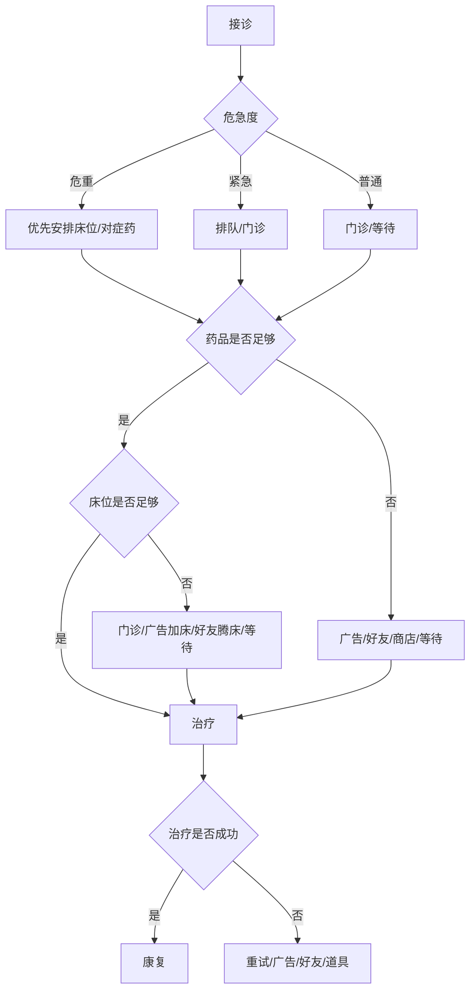

# 05-治疗资源分配系统

| 项目 | 内容 |
|---|---|
| 版本 | v1.0 |
| 日期 | 2026-10-29 |
| 负责人 | 策划 |
| 状态 | 规划态 |
| 依赖文件 | 03-核心循环与单局流程.md、04-诊断小游戏系统.md |

> **说明**：本文设计药品、床位、时间、爱心、金币五类资源的产出/消耗与轻策略分配。所有数值为建议初值，需在软测中验证。

## 1. 目标与范围

- 让玩家在有限资源下做 3-5 个有意义的取舍，而不是堆数值。
- 资源不足时提供广告、好友、等待三条免费路径，避免付费死锁。
- 输出资源表、分诊规则、治疗伪代码、失败恢复、初值建议与验收标准。

不包含：长线经济曲线（见 07）、广告/内购具体接入（见 11/12）。

### 1.1 输入依赖

- 03 单局流程：治疗阶段时长、决策点与失败兜底。
- 04 诊断结果：星级、误诊次数对治疗的加成/惩罚。
- 10 配置表：药品、床位、治疗阈值与奖励字段。
- 缺失时：若诊断星级口径未定，先用固定加成占位，不调长线数值。

## 2. 五类资源

| 资源 | 产出 | 消耗 | 设计目的 | 免费获取 |
|---|---|---|---|---|
| 药品 | 每日补给、任务、广告、好友 | 每个病例按症状消耗 | 让玩家做“用对药”的选择 | 每日补给、广告、好友 |
| 床位 | 医院等级、扩建、装饰 | 住院病例占用 | 制造轻排队与优先级 | 等待、广告临时加床、好友腾床 |
| 时间 | 医生班次、自然恢复 | 诊断/治疗/康复 | 控制节奏，提供加速点 | 等待、广告加速、好友加速 |
| 爱心 | 分享、助力、任务、月卡 | 领养、特殊治疗 | 社交与付费的软货币 | 分享、助力、任务 |
| 金币 | 病例结算、任务、成就 | 扩建、装饰、道具 | 长线经营的主货币 | 病例、任务、广告双倍 |

**原则：** 药品/床位/时间是“单局资源”，爱心/金币是“长线资源”；不要让单局资源直接决定付费，否则会变成付费门槛。

## 3. 分诊与危急度

| 危急度 | 表现 | 等待惩罚 | 处理建议 |
|---|---|---|---|
| 普通 | 精神尚可、症状轻 | 无/轻微 | 可门诊 |
| 紧急 | 疼痛、呕吐、呼吸急促 | 好感度/口碑小幅下降 | 优先处理 |
| 危重 | 虚弱、出血（卡通化）、昏迷 | 治疗难度上升、奖励下降 | 优先床位/药品 |

**硬规则：**

- 不做“宠物死亡”作为失败惩罚；用“病情加重、治疗难度上升、奖励减少”替代，避免强负反馈与伦理问题。
- 危重病例等待过久会降低星级，但不会让玩家永久失去宠物。
- 分诊只是轻优先级，不做复杂排班表。

## 4. 治疗分配伪代码（建议）

```text
startTreatment(caseData, inventory):
  required = caseData.requiredMedicine
  availableBeds = inventory.beds - occupiedBeds

  if inventory.medicine[required] <= 0:
    return fail("缺少对症药品", offer: [ad, friendAssist, shop, wait])

  if availableBeds <= 0 and caseData.needsBed:
    return fail("床位不足", offer: [ad, friendAssist, expand, wait])

  applyMedicine(required)
  if caseData.needsBed:
    occupyBed(caseData)

  healing = baseHealing
    + medicineMatchBonus
    + equipmentBonus
    + staffBonus
    - delayPenalty
    - wrongMedicinePenalty

  if healing >= caseData.cureThreshold:
    return success(score(healing))
  else:
    return partial("病情稳定，但需要继续护理", offer: [retry, ad, friendAssist])
```

## 5. 决策流程



## 6. 一局 3-5 个决策点

| 决策点 | 选择 | 影响 |
|---|---|---|
| 先治谁 | 危重/紧急/普通 | 等待惩罚、奖励 |
| 用什么药 | 对症/保守/冒险 | 治疗成功率、药品消耗 |
| 是否住院 | 住院/门诊 | 床位占用、康复速度 |
| 是否加速 | 等待/广告/好友 | 时间成本、广告收入 |
| 是否继续护理 | 继续/结算 | 好感度、星级 |

**边界：** 不超过 5 个决策点；每个决策点的信息必须可见，不能靠猜。

## 7. 资源不足时的免费路径

| 场景 | 免费路径 1 | 免费路径 2 | 免费路径 3 | 付费路径 |
|---|---|---|---|---|
| 缺药 | 等待每日补给 | 看广告获得应急药 | 好友助力送药 | 金币/内购 |
| 缺床位 | 门诊治疗（奖励降低） | 看广告临时加床 | 好友助力腾床 | 扩建/内购 |
| 时间不够 | 等待 | 看广告加速 50% | 好友助力加速 | 月卡/加速券 |
| 爱心不足 | 分享/助力 | 每日任务 | 看广告领爱心 | 爱心礼包 |

**硬规则：** 任何资源不足都必须有至少一条“不付费也能继续”的路径；不能出现“卡死只能充值”。

## 8. 失败恢复规则

| 失败类型 | 后果 | 恢复 |
|---|---|---|
| 用错药 | 治疗失败，扣少量金币 | 重试/广告补药/好友送药 |
| 床位不足 | 转为门诊，奖励降低 | 广告加床/好友腾床/等待 |
| 延误 | 星级下降，好感度下降 | 继续护理/广告加速 |
| 治疗失败 | 病例未完成，无奖励 | 重试/道具/放弃 |
| 放弃 | 病例关闭，宠物进入待救助池 | 可稍后重试 |

**原则：** 失败是“多花一点时间/资源”，不是“永久失去”；保持治愈标签。

## 9. 数值初值建议

| 资源 | 初始值 | 每日自然恢复 | 单局消耗 | 备注 |
|---|---|---|---|---|
| 金币 | 500 | 任务/病例 | 50-200 | 主要用于扩建/装饰 |
| 爱心 | 20 | 10/日 | 5-20 | 领养/特殊治疗 |
| 床位 | 2 | 扩建 | 1/住院病例 | 初始 2 张，第 4 周扩到 4 张 |
| 药品 | 每种 3 个 | 每日补给 2 个 | 1-2/病例 | 3 种基础药 |
| 时间 | 无上限 | 自然流逝 | 诊断/治疗/康复 | 用广告/好友加速 |

> 以上为建议初值，必须在软测中验证：首日是否卡资源、广告触发是否过多、付费点是否过重。

## 10. 执行任务清单

| 编号 | 任务 | 负责 | 产出 | 截止 |
|---|---|---|---|---|
| H1 | 五类资源表与初值定稿 | 策划 | 资源表 | W3 |
| H2 | 分诊危急度与等待惩罚 | 策划 | 规则表 | W3 |
| H3 | 治疗伪代码与阈值评审 | 策划 + 服务端 | 评审记录 | W3 |
| H4 | 资源不足免费路径联调 | 客户端 + 服务端 | 联调记录 | W4 |
| H5 | 失败恢复与星级测试 | QA | 测试用例 | W4 |
| H6 | 首日资源压力软测 | 策划 + 数据 | 软测报告 | W6 |

## 11. 产出物

- 五类资源表与产消关系。
- 分诊危急度规则。
- 治疗分配伪代码与决策流程图。
- 失败恢复与免费路径矩阵。
- 数值初值表。

## 12. 验收标准

- 一局 3-5 个决策点，玩家能在 30-60 秒内完成分配。
- 资源不足时有至少一条免费路径，且提示清晰。
- 不存在付费死锁；不付费也能完成病例，只是更慢/星级更低。
- 失败不会让玩家永久失去宠物。
- 资源数值可在配置表中调整，不需要改代码。

## 13. 风险与待验证假设

1. **资源太紧**：首日频繁缺药/缺床，会让玩家觉得被逼付费；需软测首日体验。
2. **资源太松**：没有取舍，治疗变成点击下一步；需用危重病例制造压力。
3. **广告过重**：每个失败都弹广告会破坏治愈感；广告必须是可选加速。
4. **数值膨胀**：长线金币产出过快，扩建/装饰失去意义；需 07 的经济回收点。
5. **伦理风险**：不要把“没钱治病”做成真实困境；用卡通化、虚构化处理。
