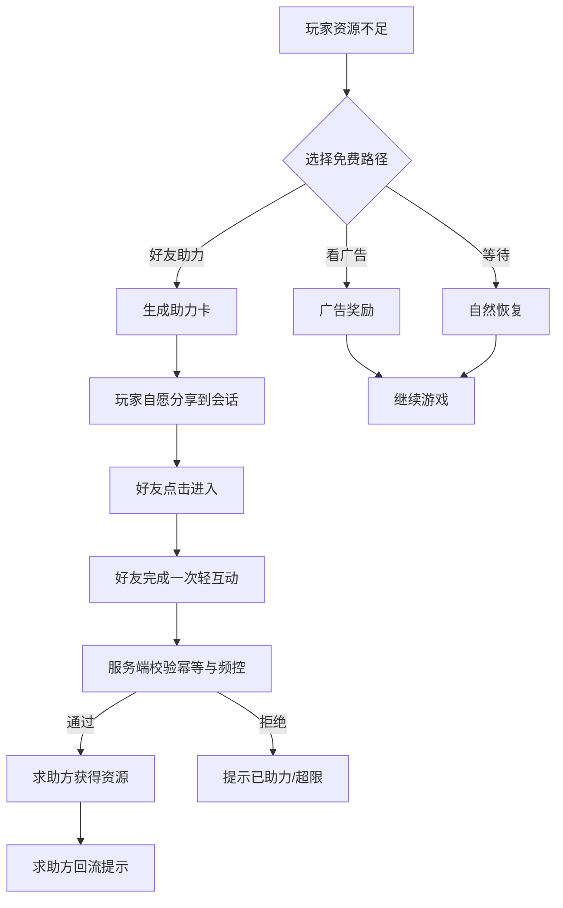

# 06-领养图鉴与社交裂变

| 项目 | 内容 |
|---|---|
| 版本 | v1.0 |
| 日期 | 2026-10-29 |
| 负责人 | 策划 + 服务端 |
| 状态 | 规划态 |
| 依赖文件 | 00-项目总览与执行边界.md、03-核心循环与单局流程.md、05-治疗资源分配系统.md |

> **说明**：本文设计“治好 → 产生好感 → 领养 → 图鉴收集 → 分享/助力”的社交闭环。所有字段与接口均为**建议**，需服务端评审后落库；分享与助力必须符合微信小游戏运营规范，不得强制分享、不得诱导群分享。

## 1. 目标与范围

- 把“治疗完成”转化为情感留存：玩家记住的是宠物，不是数值。
- 让分享成为**自愿的情感表达**，而不是领取奖励的前置条件。
- 用图鉴收集提供长线目标，用好友助力提供低成本社交触达，但不做裂变套路。
- 输出好感度、领养条件、领养位、图鉴字段、分享文案、助力链路、防刷与合规要求。

不包含：广告点位设计（见 11）、付费礼包与定价（见 12）、长线经济曲线（见 07）。

### 1.1 输入依赖

- 00 总纲：社交指标目标（分享/助力/回流/领养完成）。
- 03 单局流程：领养入口、结算与埋点约定。
- 05 资源系统：爱心、药品、床位的免费路径。
- 10 数据结构：`adoptions` 字段与索引。
- 缺失时：若 10 的字段未定，本文的图鉴卡字段仅作契约草案，不落库。

## 2. 好感度设计

### 2.1 好感度来源

| 行为 | 好感度 | 说明 |
|---|---|---|
| 完成诊断小游戏 | +10 | 按星级加成：3 星 ×1.5 |
| 治疗成功 | +20 | 部分成功 +10 |
| 康复期每日探望 | +5/天 | 上限 3 天，避免挂机刷 |
| 使用对症药品 | +5 | 奖励“用对药”，不奖励氪金 |
| 分享图鉴卡（自愿） | +5/次/天 | 每日上限 1 次 |
| 好友助力（被助力方） | +5/次/天 | 每日上限 3 次 |

### 2.2 好感度等级

| 等级 | 好感度区间 | 解锁 | 情感表达 |
|---|---|---|---|
| 初识 | 0-29 | 基础互动、喂食 | 警惕、躲闪 |
| 熟悉 | 30-69 | 抚摸、小游戏互动 | 主动靠近 |
| 信赖 | 70-119 | 专属动作、图鉴卡升级 | 蹭手、露肚皮 |
| 家人 | ≥120 | 可领养、专属故事 | 跟随玩家 |

**原则：** 好感度只影响“能不能领养”和“情感表现”，不绑定战力，不做付费加速好感度的主路径。

## 3. 领养条件与领养位

### 3.1 领养条件（建议）

| 条件 | 门槛 | 设计意图 |
|---|---|---|
| 好感度 | ≥120（家人） | 确保玩家真的陪伴过 |
| 病例完成 | 该宠物治疗成功 | 避免“跳过过程直接收集” |
| 医院等级 | ≥2 级 | 与长线扩建挂钩（见 07） |
| 领养位 | 有空位 | 制造轻规划，不做硬卡点 |
| 图鉴重复 | 允许重复领养 | 重复转为“图鉴碎片”，不惩罚 |

### 3.2 领养位获取

| 来源 | 数量 | 说明 |
|---|---|---|
| 初始 | 3 位 | 保证首日可体验一次领养 |
| 医院 2 级 | +2 位 | 首个扩建目标 |
| 医院 4 级 | +3 位 | 中期目标 |
| 领养区扩建（第 4 周） | +5 位 | 与 07 的第 4 周节奏对齐 |
| 活动/成就 | +1~2 位 | 季节活动奖励，非付费独占 |

**硬规则：** 领养位**不出售**，只能通过等级、扩建、活动获得；付费只可购买装饰与便利，不可购买领养位，避免“付费才能收集”的负面观感。

## 4. 图鉴卡设计

### 4.1 图鉴卡字段（建议，服务端落库）

| 字段 | 类型 | 说明 |
|---|---|---|
| `cardId` | string | 图鉴卡唯一 ID |
| `petSpecies` | string | 物种（猫/狗/兔/鸟等） |
| `petName` | string | 玩家命名，默认随机名 |
| `rarity` | enum | 普通/稀有/珍稀，仅影响展示边框 |
| `storyId` | string | 专属小故事 ID |
| `adoptedAt` | timestamp | 领养时间 |
| `affectionLevel` | int | 领养时的好感度等级 |
| `careScore` | int | 综合照料评分（诊断+治疗+康复） |
| `isFirstAdoption` | bool | 是否首次获得该物种 |
| `sharedCount` | int | 自愿分享次数（仅统计） |

**存储拆分（F2）：** 上表是图鉴卡展示视图；长期状态（物种、命名、稀有度、故事、好感度、照料评分）落 `pets`，`adoptions` 只存领养关系，详见 00 第 16 节 F2 与《集合与索引冻结》。

### 4.2 收集奖励

| 收集进度 | 奖励 | 说明 |
|---|---|---|
| 首次领养任一宠物 | 爱心 ×20、装饰 ×1 | 首日正反馈 |
| 集齐一个物种 3 只 | 该物种专属装饰 | 鼓励深度而非广撒网 |
| 图鉴完成 30% | 医院口碑 +5、金币 ×500 | 中期目标 |
| 图鉴完成 60% | 领养区主题皮肤 | 长线目标 |
| 图鉴完成 100% | 纪念墙、专属称号 | 荣誉型奖励，不做数值碾压 |

**原则：** 收集奖励以装饰、称号、故事为主，数值奖励为辅；避免“收集即战力”导致付费焦虑。

### 4.3 图鉴碎片

| 来源 | 数量 | 说明 |
|---|---|---|
| 完成病例（3 星/2 星/1 星） | 1 / 1 / 0 | 与 03 星级奖励一致 |
| 首次通关病例 | +2 | 每个病例仅一次 |
| 重复领养同物种 | +3 | 替代重复卡，不惩罚 |
| 每日上限 | 10 | 防刷 |

**用途：** 兑换图鉴卡边框、故事页、纪念摆件；**不直接解锁宠物或领养位**。

## 5. 分享设计

### 5.1 分享触点（全部自愿）

| 触点 | 触发 | 分享内容 | 奖励 |
|---|---|---|---|
| 领养成功 | 玩家点击“分享这一刻” | 图鉴卡 + 一句文案 | 爱心 +5（每日 1 次） |
| 图鉴里程碑 | 收集达 30%/60% | 收集进度卡 | 无额外奖励，纯展示 |
| 好友助力请求 | 玩家主动发起 | 助力卡（含求助文案） | 被助力方获得资源 |
| 医院 snapshot | 玩家点击“晒医院” | 医院外观图 | 无 |

### 5.2 分享文案（建议）

| 场景 | 文案 |
|---|---|
| 领养成功 | “今天，我把这只被遗弃的小橘带回了家。” |
| 危重转安 | “它来的时候站都站不稳，现在已经会蹭我的手了。” |
| 图鉴里程碑 | “我的小医院已经收留了 12 个毛孩子。” |
| 助力请求 | “医院床位不够了，能来搭把手吗？” |

**文案原则：** 第一人称、具体细节、情绪落点在宠物身上，不写“快来帮我点一下”“求助力”等诱导式话术。

## 6. 好友助力链路

### 6.1 流程



### 6.2 助力规则

| 规则 | 值 | 说明 |
|---|---|---|
| 每位好友每日可助力次数 | 3 次 | 防止单点刷 |
| 每位玩家每日被助力次数 | 5 次 | 控制资源注入 |
| 同一好友对同一玩家 | 1 次/天 | 幂等键 `helperId + targetId + date` |
| 助力有效期 | 24 小时 | 过期作废，不堆积 |
| 助力奖励 | 药品/床位/爱心三选一 | 由求助方选择，避免资源错配 |
| 回流判定 | 好友 7 日内未登录后经助力进入 | 计入回流指标 |

### 6.3 服务端幂等与频控（建议）

```text
POST /assist
body: { targetId, helperId, resourceType, nonce }

1. 校验 helperId 与 openid 一致（防伪造）
2. 幂等键 = helperId + targetId + yyyy-MM-dd
3. Redis/云数据库唯一索引命中 → 返回 ALREADY_ASSISTED
4. 校验 target 当日被助力次数 < 5
5. 校验 helper 当日助力次数 < 3
6. 校验 target 存在有效求助单且未过期
7. 事务内：写入 assist_log、发放资源、更新计数
8. 返回 ASSIST_SUCCESS 与最新资源
```

**要求：** 所有发奖必须服务端判定；客户端只做展示；助力单与日志保留 ≥30 天用于对账与风控。

## 7. 防刷与风控

| 风险 | 规则 |
|---|---|
| 自助力 | 校验 helperId ≠ targetId，且设备/IP 异常时二次校验 |
| 小号刷资源 | 新账号（注册 <24h）助力不计入、不发奖 |
| 脚本批量助力 | 单设备每日助力 ≤3、单 IP 每日 ≤20，超限进人工审核 |
| 分享奖励刷取 | 分享奖励每日 1 次，按 openid 维度计数 |
| 助力单伪造 | 求助单由服务端生成，带签名与过期时间 |
| 资源异常增长 | 日资源增量超过阈值触发告警与冻结 |

## 8. 合规边界（硬性）

- **不得强制分享**：任何核心玩法、领养、治疗流程不得以“分享后才能继续”为前置。
- **不得诱导群分享**：不写“分享到 3 个群解锁”“群内满 5 人领奖励”等话术。
- **保留免费替代**：分享/助力对应的资源，必须同时存在广告、等待、任务等免费路径（见 05 第 6 节）。
- **不展示真实医疗内容**：图鉴与分享素材不使用真实病历、真实宠物照片。
- **未成年人保护**：分享与助力不设付费门槛，不向未成年用户推送付费引导。
- **隐私**：分享卡不包含玩家 openid、手机号、地理位置等敏感信息。

## 9. 社交指标口径

| 指标 | 定义 | 目标 | 数据来源 |
|---|---|---|---|
| 分享率 | 当日分享人数 / 当日活跃人数 | ≥8% | 客户端埋点 + 服务端日志 |
| 助力率 | 当日发生助力的求助单 / 当日求助单 | ≥15% | 服务端 assist_log |
| 回流率 | 7 日未登录用户经分享/助力回访 / 触达人数 | ≥5% | 归因参数 + 登录日志 |
| 领养完成率 | 完成领养人数 / 进入领养流程人数 | ≥60% | 流程埋点 |
| 图鉴 30% 达成率 | 图鉴达 30% 人数 / 领养过的人数 | ≥25% | 服务端统计 |
| 助力滥用率 | 被风控拦截的助力 / 总助力请求 | <3% | 风控日志 |

**口径要求：** 所有指标按自然日、去重 openid 统计；回流需在分享链接带 `scene` 参数归因，无法归因的不计入。

## 10. 执行任务清单

| 编号 | 任务 | 负责 | 产出 |
|---|---|---|---|
| S1 | 好感度数值表与等级阈值定稿 | 策划 | 配置表 `affection_config` |
| S2 | 领养条件与领养位规则评审 | 策划 + 服务端 | 规则文档 + 接口定义 |
| S3 | 图鉴卡字段与收集奖励配置 | 策划 | 配置表 `collection_config` |
| S4 | 分享文案与素材规范 | 策划 + 美术 | 文案表 + 分享图模板 |
| S5 | 助力接口、幂等、频控实现 | 服务端 | `/assist` 接口 + 单测 |
| S6 | 分享归因与回流埋点 | 客户端 + 服务端 | 埋点表 + 看板 |
| S7 | 风控规则与告警 | 服务端 | 风控策略 + 告警配置 |
| S8 | 合规自查（强制分享/诱导群分享） | 制作人 | 自查清单 |

## 11. 产出物

- 好感度与领养规则表（可直接转配置）。
- 图鉴卡字段定义与收集奖励表。
- 分享文案库与素材模板清单。
- 助力时序、幂等与频控说明。
- 社交指标看板口径文档。
- 合规自查清单。

## 12. 验收标准

- 策划可仅凭本文配置出好感度、领养、图鉴三张表，无需口头补充。
- 助力接口在重复请求、并发请求、过期请求下均不重复发奖（单测覆盖）。
- 分享流程断网、取消分享、好友未登录三种情况下均可正常回到游戏，不卡死。
- 全部分享/助力入口均有免费替代路径，合规自查无“强制分享/诱导群分享”项。
- 社交指标可在看板按日查看，口径与本文一致。
- 首日玩家可在 10 分钟内完成一次领养并获得图鉴卡（可用测试账号验证）。

## 13. 风险与待验证假设

| 风险/假设 | 说明 | 验证方式 |
|---|---|---|
| 玩家愿意为“情感”分享 | 分享率能否达 8% 取决于图鉴卡是否足够好看 | 首周 A/B 两版分享卡 |
| 助力不引发反感 | 求助文案若过强会被视为骚扰 | 软测问卷 + 分享点击率 |
| 领养位不卖不影响收入 | 需验证付费点是否足够 | 对比有无领养位付费的 LTV |
| 图鉴收集有长线动力 | 30% 达成率是否达标 | 14 日留存 cohort 分析 |
| 回流归因准确 | 微信场景参数能否稳定归因 | 小流量灰度验证 |

> **数据说明**：本文不含真实线上社交数据；分享率、助力率等目标值为规划目标，需上线后用实际数据校准。
