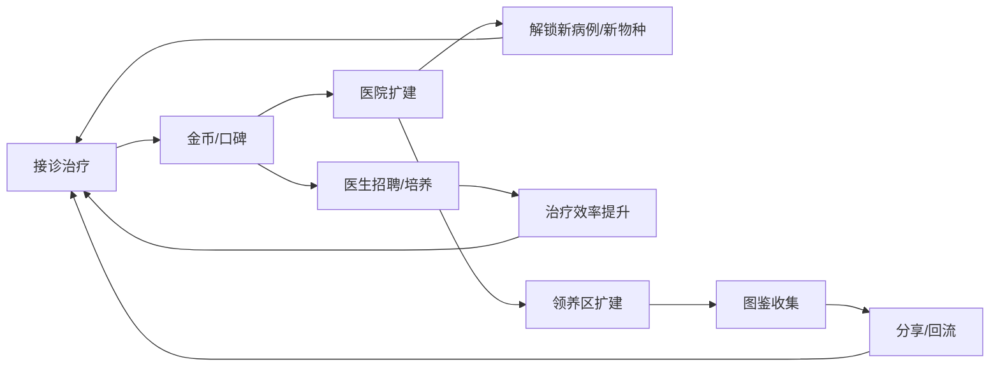

# 07-长线经营与数值节奏

| 项目 | 内容 |
|---|---|
| 版本 | v1.0 |
| 日期 | 2026-10-29 |
| 负责人 | 策划 |
| 状态 | 规划态 |
| 依赖文件 | 00-项目总览与执行边界.md、03-核心循环与单局流程.md、05-治疗资源分配系统.md、06-领养图鉴与社交裂变.md |

> **说明**：本文定义医院扩建、医生团队、口碑、季节活动与 7/14/30 日节奏。所有曲线为**假设**，需在软测中用真实数据校准；目标是让策划能据此直接配置内容表。

## 1. 目标与范围

- 用“扩建 → 解锁新病例 → 新资源压力 → 再扩建”的循环支撑 30 日留存。
- 让第 7 天、第 14 天、第 30 天各有一次明确的目标感峰值。
- 控制数值膨胀与“付费打工感”，保证免费玩家有稳定进度。
- 输出每日解锁表、周循环、产消曲线假设、回收点、防膨胀原则与待验证假设。

不包含：具体广告/内购点位（见 11/12）、变现指标口径（见 13）、性能与发布（见 15）。

### 1.1 输入依赖

- 05 资源初值与产消关系。
- 06 领养位、图鉴与好感度规则。
- 10 配置表：医院等级、医生、口碑、活动字段。
- 缺失时：若 05 的资源初值未定，本文曲线只能作方向，不进入配置。

## 2. 长线系统总览

四个长线系统：**医院扩建（空间）**、**医生团队（效率）**、**口碑（解锁与曝光）**、**季节活动（节奏）**。

## 3. 医院扩建

### 3.1 等级与解锁

| 等级 | 金币消耗（建议） | 解锁 | 目标日 |
|---|---|---|---|
| 1 级（初始） | — | 门诊、2 床位、基础病例 | D1 |
| 2 级 | 2,000 | 化验室、领养位 +2、新病例 3 种 | D3-D4 |
| 3 级 | 3,000 | 住院部、床位 +2、医生位 +1 | D7 |
| 4 级 | 6,000 | 手术室（卡通化）、领养位 +3、新物种 | D14 |
| 5 级 | 7,000 | 康复花园、床位 +3、季节活动入口 | D21 |
| 6 级 | 10,000 | 领养区扩建 +5 位、图鉴专题 | D28-D30 |

**原则：** 每级扩建都带来**新内容**而非单纯数值加成；扩建消耗以金币为主，不设“必须付费才能扩建”的硬门槛。

### 3.2 扩建节奏

- 每级扩建需 1-2 次游戏日完成，避免一次性点击升级。
- 扩建期间医院仍可接诊，但床位数临时 -1，制造轻压力。
- 扩建动画与外观变化要可见，提供“我的医院在长大”的成就感。

## 4. 医生团队

| 医生 | 获取 | 能力 | 定位 |
|---|---|---|---|
| 实习医生 | 初始 | 基础治疗 +0% | 教学 |
| 内科医生 | 金币招聘（D4） | 内科病例 +15% | 常规 |
| 外科医生 | 金币招聘（D10） | 外科病例 +15% | 常规 |
| 影像医生 | 口碑解锁（D14） | 拍片诊断时间 -20% | 效率 |
| 急诊医生 | 活动/成就（D21） | 危重病例 +20% | 稀有 |
| 院长（玩家） | 初始 | 全局 +5% | 身份感 |

**规则：**

- 医生有体力/班次，需排班，但不做复杂排班表；默认自动排班，玩家可微调。
- 医生不做抽卡；全部通过金币、口碑、活动获取，避免付费随机。
- 医生升级消耗金币与“培训点”，培训点来自病例与任务。

## 5. 口碑系统

| 口碑等级 | 口碑值 | 效果 |
|---|---|---|
| 新开张 | 0-49 | 基础病例池 |
| 小有名气 | 50-149 | 病例 +10%，解锁稀有病例 |
| 社区信赖 | 150-299 | 病例 +20%，领养位 +1 |
| 城市推荐 | 300-499 | 病例 +30%，活动优先 |
| 传奇医院 | ≥500 | 专属称号、图鉴专题 |

**口碑来源：** 治疗成功（+1~3）、五星评价（+2）、领养（+1）、图鉴里程碑（+5）、差评（-1，仅危重超时）。

**口碑衰减：** 连续 3 天不登录口碑不下降（避免惩罚性流失），但活动排名会下滑。

## 6. 季节活动

| 活动 | 周期 | 形式 | 奖励 |
|---|---|---|---|
| 春季领养季 | 3-4 月 | 限定物种、领养区装饰 | 装饰、图鉴卡 |
| 夏日急救周 | 7-8 月 | 限时高难度病例 | 金币、培训点 |
| 秋日感恩 | 10-11 月 | 老玩家回流、故事回顾 | 爱心、称号 |
| 冬季温暖 | 12-1 月 | 捐衣/捐粮主题轻玩法 | 装饰、纪念卡 |

**活动原则：**

- 活动不设付费门槛，付费只加速不锁内容。
- 活动周期与版本节奏对齐，避免同时开两个活动。
- 活动奖励以装饰与故事为主，数值奖励不超过日常 20%。

## 7. 7 日节奏（首周）

| 天数 | 解锁内容 | 核心目标 | 预期在线时长 |
|---|---|---|---|
| D1 | 教学病例 ×3、首次领养、医院 1 级 | 完成一次完整体验 | 8-12 分钟 |
| D2 | 药品补给、每日任务、分享入口 | 建立日常习惯 | 6-10 分钟 |
| D3 | 医院 2 级、化验室、新病例 3 种 | 首次扩建 | 8-12 分钟 |
| D4 | 医生招聘（内科）、口碑系统 | 理解团队 | 6-10 分钟 |
| D5 | 好友助力、领养位 +1 | 首次社交 | 6-10 分钟 |
| D6 | 危重病例、床位压力 | 体验策略取舍 | 8-12 分钟 |
| D7 | 医院 3 级、周目标结算 | 首次周成就 | 10-15 分钟 |

**首周设计原则：** 每天只引入 1 个新系统，D1 必须完成一次“诊断 → 治疗 → 领养”的完整情感闭环。

## 8. 第 2 周日常循环

| 时段 | 内容 | 时长 |
|---|---|---|
| 早间 | 收病例、领补给 | 3 分钟 |
| 午间 | 2-3 个病例、1 次广告加速 | 6-8 分钟 |
| 晚间 | 领养/图鉴、好友助力、任务结算 | 5-8 分钟 |

**第 2 周目标：** 医院 3 级 → 4 级，解锁住院部与手术室；口碑达“小有名气”；图鉴达 10%-15%。

**日常任务（建议）：**

| 任务 | 奖励 | 上限 |
|---|---|---|
| 完成 3 个病例 | 金币 ×200 | 每日 |
| 完成 1 次领养/探望 | 爱心 ×5 | 每日 |
| 分享或助力 1 次 | 爱心 ×5 | 每日 |
| 观看 1 次广告 | 药品 ×1 | 每日 |

## 9. 第 4 周目标（领养区扩建）

| 目标 | 门槛 | 奖励 |
|---|---|---|
| 医院 5 级 | 金币 7,000 | 康复花园、活动入口 |
| 领养区扩建 | 医院 5 级 + 图鉴 20% | 领养位 +5、主题装饰 |
| 图鉴 30% | 领养 15 只 | 金币 ×500、口碑 +5 |
| 口碑“社区信赖” | 口碑 150 | 稀有病例池 |

**第 4 周设计原则：** 用“领养区扩建”作为月度目标峰值，让玩家看到医院从“小诊所”变成“救助中心”的质变。

## 10. 产消曲线假设

> 以下为**假设值**，需在软测中按真实 DAU/留存校准；单位为单玩家日均。

### 10.1 金币

| 阶段 | 产出/日 | 消耗/日 | 净结余 | 说明 |
|---|---|---|---|---|
| D1-D3 | 1,000-1,400 | 500-800 | +500~600 | 教学期宽松 |
| D4-D7 | 1,600-2,200 | 800-1,400 | +800 | 扩建压力出现 |
| D8-D14 | 2,200-2,800 | 1,300-1,900 | +900 | 收支趋紧 |
| D15-D30 | 2,500-3,200 | 1,500-2,000 | +1,000~1,200 | 接近平衡，靠活动补充 |

**经济回收点：** 扩建（主要）、医生招聘与培训、装饰、药品补给。回收点必须“可延迟”，不能卡住核心循环。

### 10.2 爱心

| 阶段 | 产出/日 | 消耗/日 | 说明 |
|---|---|---|---|
| D1-D7 | 20-40 | 15-30 | 领养消耗为主 |
| D8-D14 | 30-60 | 25-50 | 特殊治疗 + 领养 |
| D15-D30 | 40-80 | 35-70 | 图鉴专题 + 装饰 |

**原则：** 爱心主要来自社交与任务，付费只能补充不能垄断；免费玩家日均爱心应 ≥ 付费玩家的 60%。

### 10.3 床位

| 阶段 | 床位数 | 日均占用 | 峰值占用 |
|---|---|---|---|
| D1-D3 | 2 | 1.0 | 2 |
| D4-D7 | 2-4 | 1.8 | 4 |
| D8-D14 | 4-6 | 3.5 | 6 |
| D15-D30 | 6-9 | 5.0 | 9 |

**原则：** 床位峰值占用应达到容量的 90%-100%，制造“偶尔不够”的轻压力，但通过等待/广告/好友可解决。

### 10.4 药品

| 阶段 | 日均消耗 | 日均补给 | 缺口处理 |
|---|---|---|---|
| D1-D7 | 3-5 | 4-6 | 基本平衡 |
| D8-D14 | 6-9 | 5-7 | 广告/好友补充 |
| D15-D30 | 8-12 | 7-9 | 广告/任务/商店 |

**原则：** 药品缺口是广告的主要动机之一，但每日 6-10 次广告上限内应能补足，不制造付费死锁。

## 11. 防数值膨胀与付费打工感

| 原则 | 说明 |
|---|---|
| 内容驱动而非数值驱动 | 扩建解锁新病例/新物种，不靠“攻击力 +10%”续命 |
| 付费只买时间与装饰 | 不卖数值碾压、不卖领养位、不卖随机宠物 |
| 免费玩家进度下限 | 免费玩家 30 日应达到医院 5 级、图鉴 25% |
| 每日收益有上限 | 防止肝帝拉开过大差距，也防止脚本刷 |
| 回收点可延迟 | 金币不足时可继续玩，只是扩建变慢 |
| 不做每日必做清单压迫 | 任务 3-4 条，10 分钟内可完成 |
| 不做付费专属剧情 | 所有故事免费玩家可解锁，付费只加速 |

## 12. 软测需验证的 5 个数值假设

| 编号 | 假设 | 验证指标 | 通过线 |
|---|---|---|---|
| H1 | 首周金币净结余 +500~800 足以支撑 D7 扩建 | D7 医院 3 级达成率 | ≥70% |
| H2 | 床位峰值 90%-100% 制造压力但不劝退 | 床位不足导致的流失率 | <5% |
| H3 | 药品缺口可由广告补足 | 日均广告观看次数 | 6-10 次 |
| H4 | 免费玩家 30 日可达医院 5 级 | D30 医院 5 级达成率 | ≥50% |
| H5 | 爱心免费产出 ≥ 付费玩家 60% | 免费/付费爱心比 | ≥0.6 |

**验证方法：** 软测 2 周，按 cohort 分析；未达标的假设需调整产出/消耗系数后复测。

## 13. 执行任务清单

| 编号 | 任务 | 负责 | 产出 |
|---|---|---|---|
| E1 | 医院等级与扩建消耗表 | 策划 | `hospital_level_config` |
| E2 | 医生表与招聘/培训规则 | 策划 | `doctor_config` |
| E3 | 口碑等级与效果表 | 策划 | `reputation_config` |
| E4 | 季节活动模板 | 策划 | `event_config` |
| E5 | 7/14/30 日解锁表 | 策划 | `unlock_schedule` |
| E6 | 产消曲线初值与回收点 | 策划 + 数据 | 数值表 v0.1 |
| E7 | 软测假设埋点与看板 | 数据 | 埋点表 + 看板 |
| E8 | 数值复盘与调参 | 策划 + 数据 | 调参记录 v0.2 |

## 14. 产出物

- 医院等级、医生、口碑、活动四张配置表。
- 7/14/30 日解锁排期表。
- 金币/爱心/床位/药品产消曲线假设表。
- 经济回收点清单。
- 软测 5 个假设的验证方案与看板。

## 15. 验收标准

- 策划可仅凭本文配置出医院等级、医生、口碑、活动内容表，无需额外口头说明。
- 7 日解锁表与 06 的领养位获取、05 的资源初值一致，无冲突。
- 产消曲线每个阶段都有明确的产出、消耗、净结余与回收点。
- 5 个数值假设均有可量化指标与通过线，可在软测中直接验证。
- 免费玩家 30 日路径可完整走通，无付费硬门槛。
- 无“必须看广告才能继续”的死锁点。

## 16. 风险与待验证假设

| 风险/假设 | 说明 | 验证方式 |
|---|---|---|
| 扩建消耗过高导致卡关 | D7 扩建金币是否够 | 首周 cohort 分析 |
| 床位压力过大劝退 | 峰值占用是否过载 | 流失漏斗 |
| 医生系统过重 | 排班是否增加认知负担 | 软测问卷 |
| 活动与主线冲突 | 活动是否挤占日常 | 活动期留存对比 |
| 数值膨胀失控 | 30 日后金币是否溢出 | D30 经济快照 |

> **数据说明**：本文所有曲线为规划假设，不含真实线上数据；上线后需按 cohort 复盘并更新为 v1.1。
