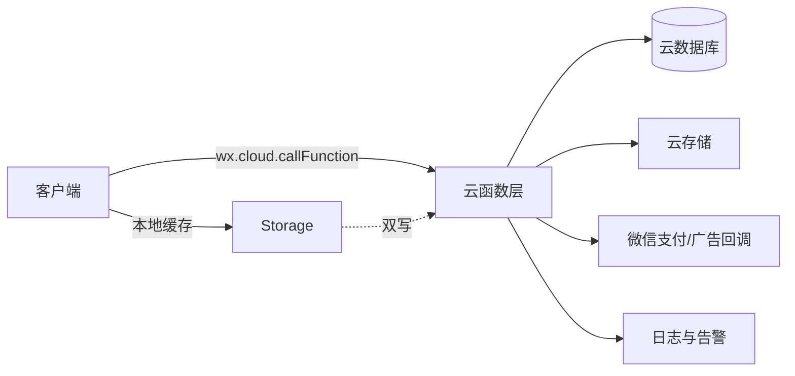
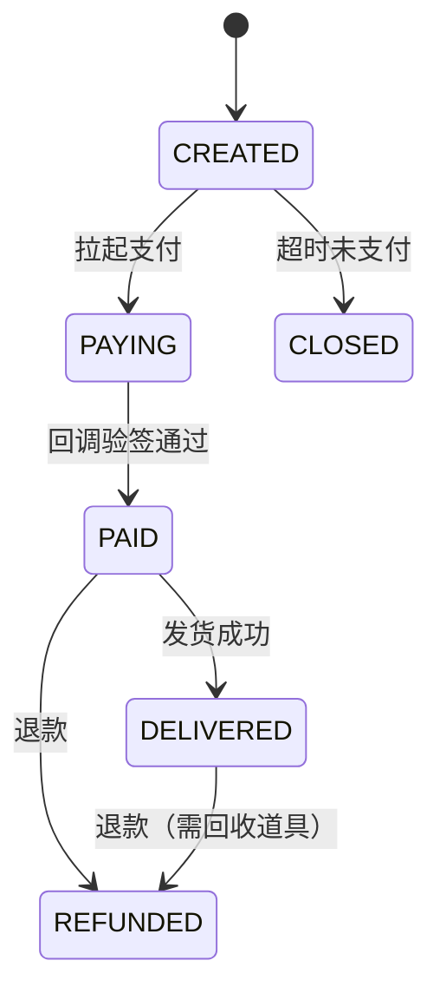

# 09-服务端架构与云存档

| 项目 | 内容 |
|---|---|
| 版本 | v1.0 |
| 日期 | 2026-10-29 |
| 负责人 | 服务端 |
| 状态 | 规划态 |
| 依赖文件 | 00-项目总览与执行边界.md、03-核心循环与单局流程.md、06-领养图鉴与社交裂变.md、08-客户端架构与状态机.md |

> **说明**：本文规划微信云开发服务端，不含已部署代码。所有云函数名、集合名、字段均为**建议**；实际以评审后的接口契约与 10 号文件为准。原则：服务端权威、全部写操作幂等、金额以“分”为单位。

## 1. 目标与范围

- 定义 10 个核心云函数的职责、入参出参、幂等与频控要求。
- 给出云存档双写、版本迁移、支付与广告回调的处理原则。
- 明确 iOS/Android 虚拟支付政策的判断流程与降级方案。
- 输出函数表、时序、错误码、验收标准。

不包含：集合字段全表（见 10）、广告位与奖励配置（见 11）、SKU 与定价（见 12）。

### 1.1 输入依赖

- 08 客户端请求约定与重试队列。
- 06 助力幂等、频控与社交指标口径。
- 10 集合、索引与配置字段。
- 缺失时：若 10 未定，本文接口只能定义到字段级，不进入建表。

## 2. 总体架构



**分层：**

| 层 | 职责 |
|---|---|
| 接入层 | 登录态校验、参数校验、频控、幂等 |
| 业务层 | 病例结算、领养、助力、订单、排行榜 |
| 数据层 | 集合读写、事务、索引 |
| 回调层 | 支付回调、广告事件回传、对账 |

## 3. 云函数清单（建议）

| 函数 | 职责 | 幂等键 | 频控 | 关键校验 |
|---|---|---|---|---|
| `login` | 换取 openid、签发会话、返回基础资料 | 无（读） | 10 次/分/设备 | 场景值、版本号 |
| `getProfile` | 拉取用户、医院、资源、图鉴摘要 | 无（读） | 30 次/分 | 会话有效 |
| `saveGame` | 保存医院/资源快照 | `openid + revision` | 10 次/分 | 版本号递增，拒绝回退 |
| `syncCaseResult` | 单局结算、发奖、写病例记录 | `openid + caseSessionId` | 20 次/分 | 服务端重算评分与奖励 |
| `leaderboard` | 口碑/图鉴/周榜查询 | 无（读） | 20 次/分 | 榜单类型白名单 |
| `assist` | 好友助力发资源 | `helperId + targetId + date` | 3 次/日/人 | 求助单有效、非自助力 |
| `adEvent` | 上报广告完成、发奖励 | `openid + adSessionId` | 按广告位配置 | `isEnded`、广告位白名单 |
| `createOrder` | 创建订单、返回支付参数 | `openid + clientOrderId` | 5 次/分 | SKU 白名单、价格服务端读取 |
| `payCallback` | 支付回调验签、发货 | `transactionId` | 平台回调 | 验签、金额、状态机 |
| `getConfig` | 下发配置与版本 | 无（读） | 60 次/分 | 版本、灰度标签 |

### 3.1 统一返回结构

```text
{ code: 0, msg: "ok", data: {...}, serverTime: 1730000000000 }
```

| 错误码 | 含义 | 客户端处理 |
|---|---|---|
| 0 | 成功 | 正常 |
| 1001 | 会话失效 | 重新登录 |
| 1002 | 参数错误 | 提示，不重试 |
| 1003 | 频控 | 提示稍后 |
| 1004 | 幂等重复 | 返回上次结果，不重复发奖 |
| 2001 | 资源不足 | UI 引导免费路径 |
| 2002 | 状态非法 | 刷新状态 |
| 3001 | 订单不存在/金额不符 | 告警，人工核查 |
| 3002 | 支付不可用（W1–W4 `PAY_UNAVAILABLE`） | 隐藏/禁用付费入口 |

## 4. 关键函数设计

### 4.1 login

```text
login({ scene, version, channel }):
  1. 通过 cloud.getWXContext() 获取 OPENID（不信任客户端传入）
  2. 查询 users，不存在则创建（初始化资源、医院 1 级）
  3. 生成会话 token（含 openid、过期时间），写入会话集合或签名 JWT
  4. 返回 { token, isNewUser, serverTime, minVersion }
```

**要求：** openid 只从上下文取；不接受客户端自报身份；新用户初始化必须幂等（并发登录只创建一次）。

### 4.2 saveGame

```text
saveGame({ revision, snapshot }):
  1. 校验会话
  2. 读取当前 revision
  3. if revision <= current: return 1004 + 最新快照
  4. 校验字段范围（资源不为负、等级不跳级）
  5. 事务写 hospital_state + users 资源摘要
  6. 返回新 revision
```

**原则：** 存档以服务端为准；客户端快照仅作参考，服务端做合法性校验；拒绝回退版本，防止覆盖。

### 4.3 syncCaseResult

```text
syncCaseResult({ caseSessionId, caseId, diagnosis, treatment, durationMs }):
  1. 幂等：caseSessionId 已存在 → 返回历史结果
  2. 校验病例存在、未结算
  3. 服务端重算：星级、治疗结果、奖励（不信任客户端传入奖励）
  4. 事务：写 pets_cases 记录、更新资源、口碑、好感度、图鉴
  5. 返回结算详情与最新资源
```

**要求：** 奖励公式在服务端唯一实现；客户端只做展示；异常单据进入人工核查队列。

### 4.4 assist

幂等与频控见 06 第 6 节，服务端需额外校验求助单签名与过期时间。

### 4.5 adEvent

```text
adEvent({ adSessionId, adUnitId, scene, isEnded }):
  1. 校验 idempotencyKey（openid:adSessionId）未使用（唯一索引）
  2. 校验 adUnitId 在配置白名单、scene 合法
  3. 校验 isEnded == true，否则不发奖
  4. 校验当日该广告位次数 < 上限（默认 6-10 次，见 11）
  5. 发奖并写 ad_events
  6. 返回奖励与服务端计数
```

**要求：** 客户端上报仅作触发，最终以服务端频控为准；与平台报表按日对账，差异 >5% 告警。

### 4.6 createOrder / payCallback

```text
createOrder({ skuId, clientOrderId }):
  1. 幂等：clientOrderId 已存在 → 返回原订单
  2. 服务端读取 SKU 价格（不信任客户端金额）
  3. 创建订单 status=CREATED，调用统一下单
  4. 返回支付参数

payCallback(platformPayload):
  1. 验签（平台密钥）
  2. 幂等：transactionId 已处理 → 直接返回成功
  3. 校验金额、SKU、openid 与订单一致
  4. 状态机：CREATED → PAID → DELIVERED
  5. 事务发货，写 orders 与发货日志
  6. 返回成功应答（必须快速，避免平台重试）
```

**订单状态机：**



**要求：** 发货必须幂等；回调先应答后异步补偿；每日对账订单与平台流水；退款需回收对应权益并留痕。

## 5. 云存档双写与版本迁移

### 5.1 双写策略

| 数据 | 主存储 | 副本 | 一致性 |
|---|---|---|---|
| 用户与资源 | 云数据库 | 本地快照 | 服务端为准 |
| 医院状态 | 云数据库 | 本地快照 | revision 乐观锁 |
| 图鉴/领养 | 云数据库 | 本地只读缓存 | 写后刷新 |
| 配置 | 云存储/数据库 | 本地缓存 | 版本号校验 |

**流程：**

1. 客户端写操作先调云函数，成功后更新本地快照。
2. 冷启动以服务端为准，本地快照仅用于首屏加速。
3. 冲突时以 `revision` 大者为准，较小者丢弃并提示“已同步”。

### 5.2 版本迁移

| 场景 | 策略 |
|---|---|
| 字段新增 | 读取时给默认值，惰性迁移 |
| 字段改名 | 双读兼容一个版本，再下线旧字段 |
| 结构变更 | 迁移脚本 + 版本号，分批执行 |
| 回滚 | 保留上一版本快照 ≥7 天 |

**要求：** 迁移脚本必须可重入；迁移期间禁止写入不兼容结构；迁移完成后抽样校验。

## 6. 广告与支付回调原则

| 原则 | 说明 |
|---|---|
| 验签优先 | 支付回调必须验签，失败直接拒绝并告警 |
| 幂等发货 | 以 `transactionId` 为唯一键，重复回调不重复发货 |
| 金额校验 | 回调金额必须等于订单金额，防篡改 |
| 快速应答 | 回调处理超时会触发平台重试，先应答后补偿 |
| 对账 | 每日订单、发货、退款三方对账，差异进工单 |
| 广告对账 | 服务端计数与平台报表按日比对，差异 >5% 告警 |

## 7. iOS/Android 虚拟支付政策判断

> **重要：** 微信小游戏虚拟支付政策会调整，以下为判断框架，**上线前必须以微信官方最新文档为准**，不得凭本文直接上线。

| 平台 | 判断点 | 处理建议 |
|---|---|---|
| Android | 是否接入微信虚拟支付、是否完成资质 | 按官方要求接入，服务端校验 |
| iOS | 当前是否允许虚拟支付、允许的类目与形式 | 若不允许，关闭内购入口，仅保留 IAA；不引导站外支付 |
| 通用 | 是否存在诱导跳转、外部支付 | 禁止；发现即下线 |

**降级方案：**

- iOS 不可内购时，隐藏所有付费入口，保留广告与免费路径。
- 不通过客服、二维码、跳转链接等方式绕过平台政策。
- 版本发布前由制作人 + 法务确认政策快照，并记录判断依据与日期。

## 8. 安全与风控

| 风险 | 措施 |
|---|---|
| 伪造 openid | 只从 `getWXContext()` 获取 |
| 重放请求 | 幂等键 + 时间窗（±5 分钟） |
| 刷奖励 | 服务端重算奖励 + 日上限 + 异常告警 |
| 篡改金额 | 价格只从服务端 SKU 读取 |
| 越权查询 | 所有查询带 openid 过滤，禁止跨用户读 |
| 数据泄露 | 日志脱敏，禁止打印 token 与支付报文全文 |

## 9. 执行任务清单

| 编号 | 任务 | 负责 | 产出 |
|---|---|---|---|
| B1 | 云开发环境与权限初始化 | 服务端 | 环境、集合、权限 |
| B2 | 会话与登录态方案 | 服务端 | `login` + 会话校验中间件 |
| B3 | 存档读写与乐观锁 | 服务端 | `saveGame` + 单测 |
| B4 | 单局结算与奖励重算 | 服务端 | `syncCaseResult` |
| B5 | 助力与频控 | 服务端 | `assist` + 风控 |
| B6 | 广告事件与对账 | 服务端 | `adEvent` + 对账脚本 |
| B7 | 订单、回调、发货、退款 | 服务端 | `createOrder`/`payCallback` |
| B8 | 配置下发与灰度 | 服务端 | `getConfig` |
| B9 | 迁移脚本与回滚预案 | 服务端 | 迁移工具 + 演练记录 |
| B10 | 监控告警与日志规范 | 服务端 | 告警规则 + 日志规范 |

## 10. 产出物

- 云函数清单与接口契约（入参/出参/错误码）。
- 集合与索引草案（与 10 对齐）。
- 幂等、频控、验签实现说明。
- 云存档双写与迁移方案。
- 支付/广告回调与对账流程。
- iOS/Android 政策判断记录模板。

## 11. 验收标准

- 10 个云函数均有明确入参、出参、错误码与幂等键。
- 重复调用 `syncCaseResult`、`assist`、`payCallback` 均不重复发奖/发货（单测覆盖）。
- 模拟篡改金额、伪造 openid、重放请求均被拒绝并告警。
- 存档冲突场景下以服务端为准，客户端可恢复且不丢关键进度。
- 支付沙箱可完成“下单 → 支付 → 回调 → 发货 → 查询”闭环。
- 广告奖励可按日与平台报表对账，差异可定位到具体 `adSessionId`。
- iOS 不可内购时，付费入口完全隐藏且无绕过路径。

## 12. 风险与待验证假设

| 风险/假设 | 说明 | 验证方式 |
|---|---|---|
| 云开发配额足够 | 并发与读写可能触顶 | 压测 + 配额评估 |
| 回调延迟可控 | 平台重试可能造成重复 | 幂等用例 |
| 迁移不丢数据 | 结构变更风险 | 预发演练 |
| iOS 政策判断准确 | 政策可能变化 | 上线前官方文档复核 |
| 对账差异可解释 | 广告/支付统计口径不同 | 差异样本核查 |

> **数据说明：** 本文不含真实并发、订单或广告数据；配额与性能需在预发环境压测确认。
