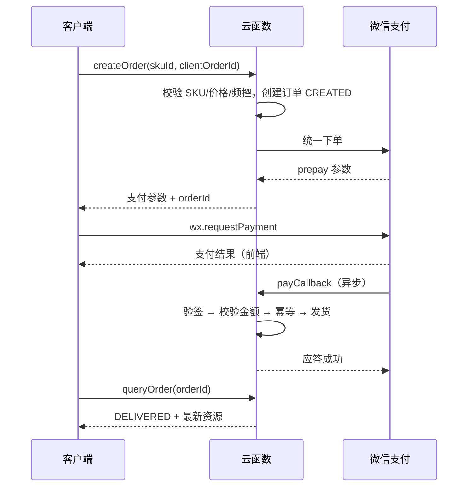
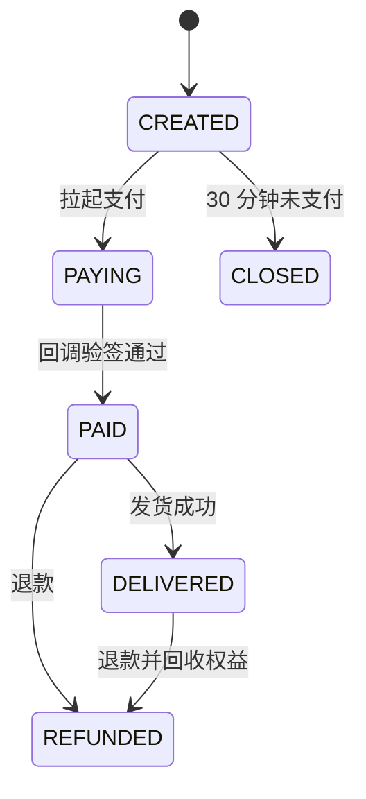

# 12-IAP内购与支付

| 项目 | 内容 |
|---|---|
| 版本 | v1.0 |
| 日期 | 2026-10-29 |
| 负责人 | 服务端 + 客户端 |
| 状态 | 规划态 |
| 依赖文件 | 00-项目总览与执行边界.md、07-长线经营与数值节奏.md、09-服务端架构与云存档.md、10-数据结构与配置表.md |

> **说明**：本文设计内购 SKU、定价原则与支付链路。所有 SKU、价格、接口均为**建议**，需运营与法务评审。原则：不做“付费才能救活”，不做付费随机抽宠物，价格服务端配置，iOS/Android 分平台判断。

## 1. 目标与范围

- 定义 7 类 SKU 与 6/30/68 元价格带。
- 给出支付时序、幂等发货、查单补偿、退款与对账方案。
- 明确付费边界与合规红线。
- 输出 SKU 表、时序图、状态机与验收标准。

不包含：广告系统（见 11）、变现模型（见 13）、平台政策完整解读（见 09 第 7 节）。

### 1.1 输入依赖

- 07 长线经济与回收点（决定 SKU 内容量）。
- 09 订单状态机、回调与对账原则。
- 10 `orders`/`skus_config` 字段与金额规范。
- 缺失时：商户资质未到位时只做沙箱，不开放正式支付。
- **F1 冻结**：W1–W4 `createOrder`/`payCallback` 只返回 `3002 PAY_UNAVAILABLE`，不调用真实虚拟支付；iOS 隐藏付费入口。

## 2. 付费设计原则

| 原则 | 说明 |
|---|---|
| 不卖胜利 | 不卖“直接治愈”“跳过诊断”的核心结果 |
| 不卖随机宠物 | 领养靠好感度与流程，不做抽卡 |
| 不卖领养位 | 领养位只通过等级/扩建/活动获得（见 06） |
| 价格服务端配置 | 客户端不传价格，防止篡改 |
| 免费路径完整 | 所有资源都有广告/等待/任务替代 |
| 透明 | 购买前展示内容、有效期、是否自动续费 |
| 未成年人保护 | 不向未成年用户做诱导性付费引导 |

## 3. SKU 设计（建议）

| SKU | 类型 | 价格（元） | 内容 | 定位 |
|---|---|---|---|---|
| 周卡 | 订阅/卡 | 6 | 7 天每日金币 ×100、爱心 ×5 | 低门槛尝鲜 |
| 月卡 | 订阅/卡 | 30 | 30 天每日金币 ×150、爱心 ×10、1 次免费加床/日 | 主力留存付费 |
| 装饰包·温馨诊室 | 装饰 | 30 | 主题装饰 ×3 | 情感表达 |
| 装饰包·康复花园 | 装饰 | 68 | 主题装饰 ×6 + 限定摆件 | 高客单收藏 |
| 专家医生·影像顾问 | 医生 | 68 | 拍片诊断时间 -20%（与免费医生不叠加数值碾压） | 效率 |
| 领养证书 | 纪念 | 30 | 图鉴卡专属边框 + 故事页 | 纯展示 |
| 救助基金礼包 | 礼包 | 68 | 爱心 ×200、药品包 ×3、纪念徽章 | 高客单资源包 |
| 爱心小袋 | 资源 | 6 | 爱心 ×80 | 小额补充 |
| 爱心大袋 | 资源 | 30 | 爱心 ×450 | 中额补充 |

**价格带：** 6 / 30 / 68 元三档，首购推荐 6 元周卡或爱心小袋；月卡为长期价值锚点；68 元为高客单效率/收藏品，不做数值碾压。

**命名注意：** “救助基金”为游戏内虚拟礼包命名，**不得暗示真实公益捐赠或善款流向**；如需公益联动，必须单独取得资质与授权。

## 4. 支付时序



**关键点：**

- 前端支付成功只作展示，**发货以服务端回调为准**。
- 回调未到时，客户端轮询 `queryOrder`；服务端可主动向平台查单补偿。
- 回调必须快速应答，重活异步处理，避免平台重试风暴。

## 5. 订单状态机



| 状态 | 可执行操作 |
|---|---|
| `CREATED` | 拉起支付、超时关闭 |
| `PAYING` | 等待回调、主动查单 |
| `PAID` | 发货（幂等） |
| `DELIVERED` | 查询、退款申请 |
| `CLOSED` | 只读 |
| `REFUNDED` | 只读，记录回收结果 |

## 6. 幂等、验签与查单

```text
payCallback(payload):
  1. verifySign(payload) 失败 → 拒绝 + 告警
  2. 读 order by orderId，校验存在
  3. 校验 amountFen、skuId、openid 一致
  4. if order.status in [DELIVERED, REFUNDED]: return SUCCESS   // 幂等
  5. transactionId 唯一索引写入，冲突则视为已处理
  6. 事务：更新 PAID → 发放权益 → DELIVERED → 写发货日志
  7. return SUCCESS
```

**查单补偿：**

```text
queryOrder(orderId):
  1. 读本地订单
  2. if status in [PAID, DELIVERED]: 返回
  3. 调用平台查单接口
  4. 平台已支付但本地未发货 → 走发货（幂等）
  5. 平台未支付且超时 → 关闭订单
```

**要求：** 所有发货写 `delivery_log`（orderId、skuId、items、operator、时间），支持对账与回滚。

## 7. 退款与对账

| 环节 | 规则 |
|---|---|
| 退款入口 | 客服工单，游戏内不直接提供自助退款 |
| 退款条件 | 未发货直接退；已发货需回收权益或按比例 |
| 权益回收 | 扣回金币/爱心/装饰/医生，不足则标记负余额并限制消费 |
| 状态更新 | 退款成功 → `REFUNDED`，写退款日志 |
| 对账 | 每日订单、支付、发货、退款四方对账 |
| 差异处理 | 差异订单进工单，24 小时内核查 |

## 8. 平台政策与降级

- **Android：** 按微信小游戏虚拟支付要求接入，完成资质与类目。
- **iOS：** 上线前以微信官方最新政策为准；若不允许虚拟支付，**隐藏全部内购入口**，仅保留 IAA 与免费路径。
- **禁止：** 引导站外支付、二维码收款、客服代充、跳转外部链接。
- **判断记录：** 每次发版记录政策快照、判断人、日期，存档备查。

## 9. 客户端要求

| 要求 | 说明 |
|---|---|
| 价格展示 | 从服务端配置读取，不硬编码 |
| 支付中状态 | 锁定重复点击，展示 loading |
| 支付取消 | 回到原页面，不报错 |
| 支付成功 | 轮询订单状态，未到账提示“稍后自动补发” |
| 失败重试 | 提供“重新查询”，不重复下单 |
| 恢复购买 | 卡类按到期时间展示，不重复扣费 |

## 10. 执行任务清单

| 编号 | 任务 | 负责 | 产出 |
|---|---|---|---|
| P1 | SKU 与价格评审 | 制作 + 运营 | SKU 表 |
| P2 | 微信支付商户号与资质 | 运营 | 商户配置 |
| P3 | `createOrder` 与统一下单 | 服务端 | 云函数 |
| P4 | `payCallback` 验签与发货 | 服务端 | 回调 + 单测 |
| P5 | `queryOrder` 查单补偿 | 服务端 | 查单任务 |
| P6 | 客户端支付流程与状态 | 客户端 | 支付模块 |
| P7 | 退款与权益回收 | 服务端 + 客服 | 退款流程 |
| P8 | 对账脚本与日报 | 服务端 + 财务 | 对账日报 |
| P9 | iOS 降级开关 | 客户端 + 服务端 | 平台开关 |
| P10 | 合规与文案审查 | 制作 + 法务 | 审查记录 |

## 11. 产出物

- SKU 表（含价格、内容、平台、上下架）。
- 支付时序与订单状态机。
- 幂等、验签、查单、退款实现说明。
- 对账脚本与日报模板。
- iOS/Android 政策判断记录。
- 付费文案与合规审查记录。

## 12. 验收标准

- 沙箱环境完成“下单 → 支付 → 回调 → 发货 → 查询”闭环。
- 同一 `transactionId` 重复回调 10 次，只发货 1 次。
- 篡改金额、伪造回调、跨用户订单均被拒绝并告警。
- 回调丢失时，查单补偿可在 5 分钟内完成发货。
- 支付取消、失败、超时均不产生脏订单，可重新下单。
- 修改价格仅需改服务端配置，客户端无需发版。
- iOS 不可内购时，内购入口完全隐藏且无绕过路径。
- 退款可回收权益并留痕，订单状态正确。

## 13. 风险与待验证假设

| 风险/假设 | 说明 | 验证方式 |
|---|---|---|
| 6/30/68 定价被接受 | 需验证付费意愿 | 首月付费率 |
| 月卡不破坏平衡 | 每日资源是否过量 | 经济曲线对比（见 07） |
| iOS 政策可内购 | 政策可能收紧 | 上线前官方复核 |
| 回调稳定 | 网络抖动导致丢失 | 查单补偿演练 |
| 退款可控 | 恶意退款风险 | 退款率监控 |

> **数据说明：** 本文不含真实付费率、ARPPU 或退款率；相关测算见 13，需上线后用真实数据校准。
