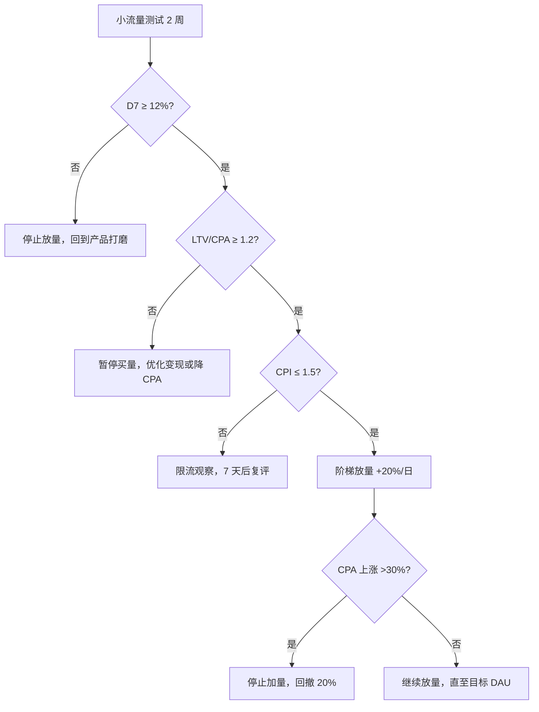

# 13-混合变现模型与指标

| 项目 | 内容 |
|---|---|
| 版本 | v1.0 |
| 日期 | 2026-10-29 |
| 负责人 | 制作 + 运营 |
| 状态 | 规划态 |
| 依赖文件 | 00-项目总览与执行边界.md、06-领养图鉴与社交裂变.md、11-IAA广告系统.md、12-IAP内购与支付.md |

> **说明**：本文建立 IAA 60% + IAP 40% 的敏感性模型。所有 DAU、eCPM、付费率、CPA 均为**假设值**，不含真实线上数据；上线后必须用实际数据替换并重算。模型用途是判断“能否放量”，不是收入承诺。

## 1. 目标与范围

- 给出保守/目标/乐观三档模型与计算公式。
- 定义回本周期、LTV/CPA、否决阈值。
- 统一全项目指标口径，供 00/06/07/15 引用。
- 输出敏感性分析与放量/降级决策规则。

不包含：广告位设计（见 11）、SKU 与支付（见 12）、性能指标（见 15）。

### 1.1 输入依赖

- 00 成功指标与 12 周目标。
- 11 广告位上限与 eCPM 假设。
- 12 SKU、价格带与付费率假设。
- 缺失时：先用本文假设值建模，上线后 2 周内用真实数据替换。

## 2. 核心公式

```text
IAA ARPDAU = 人均激励视频次数 × eCPM ÷ 1000 × (1 + 插屏/Banner 加成)
IAP ARPDAU = 付费率 × ARPPU
总 ARPDAU  = IAA ARPDAU + IAP ARPDAU
IAA 占比   = IAA ARPDAU ÷ 总 ARPDAU

LTV30 = 总 ARPDAU × 30 日人均活跃天数（CAD30）
回本天数 ≈ 30 × CPA ÷ LTV30
LTV/CPA = LTV30 ÷ CPA
```

**说明：**

- `CAD30` 由留存曲线积分近似，目标档取 4.3 天（D1 35%、D7 12%、D30 5%）。
- 插屏/Banner 加成统一取 10%；首月未开插屏、Banner 时按 0 重算。
- 金额单位统一为元；服务端订单金额以分存储（见 10）。

## 3. 三档模型

| 参数 | 保守 | 目标 | 乐观 |
|---|---|---|---|
| DAU | 10,000 | 50,000 | 150,000 |
| 人均激励视频/日 | 5.0 | 7.3 | 8.5 |
| eCPM（元） | 40 | 70 | 95 |
| IAA ARPDAU（元） | 0.22 | 0.56 | 0.89 |
| 付费率 | 1.0% | 1.85% | 2.6% |
| ARPPU（元） | 13 | 20 | 25 |
| IAP ARPDAU（元） | 0.13 | 0.37 | 0.65 |
| **总 ARPDAU（元）** | **0.35** | **0.93** | **1.54** |
| IAA 占比 | 63% | 60% | 58% |
| CAD30（天） | 3.6 | 4.3 | 4.9 |
| **LTV30（元）** | **1.26** | **4.00** | **7.55** |
| CPA（元） | 2.60 | 1.50 | 1.00 |
| **LTV/CPA** | **0.48** | **2.67** | **7.55** |
| 回本天数（近似） | >30（不回本） | ≈11 | ≈4 |
| 日流水（元） | 3,500 | 46,500 | 231,000 |

**读法：**

- 保守档 LTV/CPA <1.2，**不可放量**，只能自然量验证。
- 目标档 LTV/CPA 2.67，满足放量条件，但仍需监控 D7 与 CPA 漂移。
- 乐观档不构成承诺，仅用于上限测算与资源规划。

## 4. 敏感性分析（以目标档为基准）

| 变化 | IAA ARPDAU | 总 ARPDAU | LTV30 | LTV/CPA | 结论 |
|---|---|---|---|---|---|
| 基准 | 0.56 | 0.93 | 4.00 | 2.67 | 可放量 |
| eCPM -20% | 0.45 | 0.82 | 3.53 | 2.35 | 仍可放量，观察 |
| 人均视频 -1 次 | 0.48 | 0.85 | 3.66 | 2.44 | 仍可放量 |
| 付费率 -30% | 0.56 | 0.82 | 3.53 | 2.35 | 仍可放量 |
| CPA +50% | 0.56 | 0.93 | 4.00 | 1.78 | 预警，控制放量 |
| eCPM -30% 且 CPA +100% | 0.39 | 0.65 | 2.80 | 0.93 | **停止放量** |

**结论：** 模型对 CPA 最敏感，其次是 eCPM；优先控制买量成本，其次提升广告填充与付费转化。

## 5. 放量/降级决策



**阶梯规则：**

- 每次放量不超过 20%，观察 24-48 小时。
- CPA 连续 2 天上涨 >20%，暂停加量。
- 任一核心指标跌破否决线，回撤到上一量级。

## 6. 否决阈值

| 指标 | 目标 | 预警线 | 否决线 | 动作 |
|---|---|---|---|---|
| D1 | ≥35% | <32% | <28% | 停止放量，查新手引导 |
| D7 | ≥12% | <10% | <8% | 停止放量，查中期目标 |
| D30 | ≥5% | <4% | <3% | 降级内容投入 |
| ARPDAU | ≥0.5 | <0.4 | <0.3 | 重做变现结构 |
| LTV/CPA（30 日） | ≥1.2 | 连续 2 周 <1.4 | <1.0 | 暂停买量 |
| CPI | ≤1.5 | >1.5 | >2.0 | 限流/停投 |
| IAA 占比 | 60%±10pp | 偏离 >10pp | 偏离 >20pp | 调整广告/内购配比 |

## 7. 指标口径表

| 指标 | 定义 | 目标 | 数据来源 |
|---|---|---|---|
| D1 留存 | 次日回访去重用户 / 首日新增 | ≥35% | 登录日志 |
| D7 留存 | 第 7 日回访 / 首日新增 | ≥12% | 登录日志 |
| D30 留存 | 第 30 日回访 / 首日新增 | ≥5% | 登录日志 |
| ARPDAU | 当日总收入（IAA+IAP）/ DAU | ≥0.5 元 | 广告报表 + 订单 |
| LTV30 | 30 日累计收入 / 新增用户 | 见模型 | 分 cohort 计算 |
| CPA | 买量花费 / 新增用户 | ≤1.5 元 | 投放后台 |
| LTV/CPA | LTV30 / CPA | ≥1.2 | 计算 |
| 分享率 | 当日分享人数 / DAU | ≥8% | 埋点（见 06） |
| 助力率 | 发生助力的求助单 / 总求助单 | ≥15% | 服务端日志 |
| 回流率 | 7 日未登录经分享/助力回访 / 触达 | ≥5% | 归因 + 登录 |
| 领养完成率 | 完成领养 / 进入领养流程 | ≥60% | 流程埋点 |
| 广告观看率 | 观看激励视频人数 / DAU | ≥45% | 广告埋点 |

**口径要求：**

- 留存按自然日、去重 openid 统计，跨渠道合并。
- LTV 必须按 cohort 计算，不得用总收入 ÷ 总用户。
- CPA 含所有买量花费（含代理费），不含自然量。
- 退款从收入中扣除后再计算 ARPDAU。

## 8. 执行任务清单

| 编号 | 任务 | 负责 | 产出 |
|---|---|---|---|
| M1 | 三档模型参数确认 | 制作 + 运营 | 模型 v1.0 |
| M2 | 指标口径评审 | 数据 + 运营 | 口径文档 |
| M3 | 埋点与看板搭建 | 数据 | 留存/收入/买量看板 |
| M4 | cohort LTV 计算脚本 | 数据 | 脚本 + 日报 |
| M5 | 放量决策 SOP | 运营 | SOP 文档 |
| M6 | 周度模型复盘 | 制作 + 数据 | 复盘记录 |
| M7 | 否决阈值告警 | 数据 | 告警规则 |

## 9. 产出物

- 三档敏感性模型（可计算表格）。
- 回本周期与 LTV/CPA 公式。
- 放量/降级决策流程图与 SOP。
- 全项目统一指标口径表。
- 周度复盘模板。

## 10. 验收标准

- 运营可输入实际 DAU、eCPM、付费率、CPA，直接算出 LTV30 与 LTV/CPA。
- 三档模型的公式、口径与 00/06/07 一致，无冲突。
- 每个否决阈值都有明确动作与责任人。
- 看板可按日/周查看 D1、D7、D30、ARPDAU、LTV/CPA、CPI。
- 放量决策可按流程图执行，无需额外口头解释。
- 模型明确标注“假设值”，不含虚构线上数据。

## 11. 风险与待验证假设

| 风险/假设 | 说明 | 验证方式 |
|---|---|---|
| eCPM 达 70 元 | 受行业与季节影响 | 首月广告报表 |
| 付费率 1.85% | 治愈系付费意愿未知 | 首月订单数据 |
| CAD30 4.3 天 | 依赖留存曲线 | cohort 积分 |
| CPA 1.5 元 | 买量竞争可能推高 | 小流量测试 |
| IAA/IAP 60/40 可达成 | 可能偏向一侧 | 周度配比复盘 |

> **数据说明：** 本文全部数值为规划假设，**不得作为对外收入承诺**；上线后需以真实 cohort 数据校准，并同步更新 00 的成功指标。
