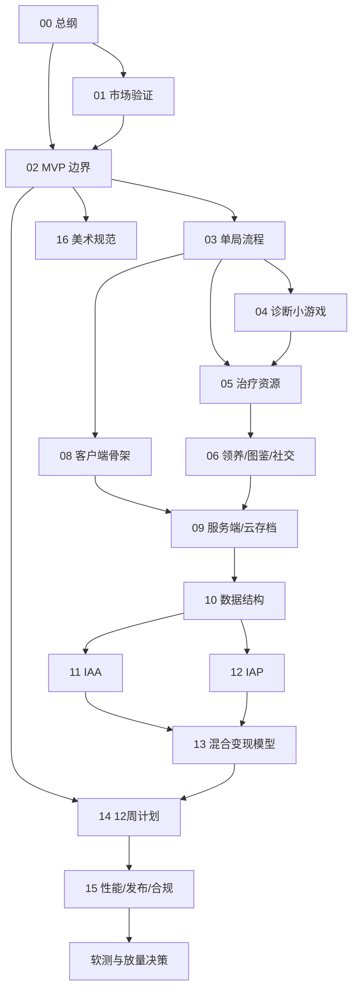

# 99-总控校验报告

| 项目 | 内容 |
|---|---|
| 版本 | v1.0 |
| 日期 | 2026-10-29 |
| 负责人 | 项目总控 |
| 状态 | 规划态 |
| 校验范围 | `docs/plan/` 下 00-16 共 17 个 Markdown 文件 |
| 校验方式 | 结构扫描 + 指标比对 + 交叉引用检查 + 关键数值复算 |

> **说明**：本报告只做一致性校验，不重写正文。校验过程中发现的结构性冲突已就地修复，修复记录见第 6 节；仍无法在文档层闭环的事项列入第 7 节“缺失清单”，需负责人确认。

## 1. 结论摘要

| 校验项 | 结果 |
|---|---|
| 文件数量 | 17/17 存在 |
| 文件头（版本/日期/负责人/状态/依赖） | 17/17 通过 |
| 六段结构（目标与范围/输入依赖/执行任务清单/产出物/验收标准/风险与待验证假设） | 17/17 通过 |
| “建议/待验证/假设”标注 | 17/17 有标注，未发现虚构已实现代码或线上数据 |
| 指标口径与 13 号文件一致 | 通过（1 处 CPI 否决线已统一） |
| 页面栈/状态机一致 | 通过（03 与 08 已统一） |
| 数据结构/广告/支付字段一致 | 通过（幂等键与订单字段已统一） |
| 14 周计划覆盖 01-16 产出物 | 通过（已补 14 自身与医院 4-6 级） |
| 发现并修复的冲突 | 12 项 |
| 残余待确认事项 | 8 项 |

**总体判断：** 文档层已具备进入执行的条件；残余事项集中在“外部数据/政策待复核”和“少量实现细节待定”，不阻塞 W1-W4 的单局开发。

## 2. 文件头检查

| 编号 | 文件 | 版本 | 日期 | 负责人 | 状态 | 依赖文件 | 结论 |
|---|---|---|---|---|---|---|---|
| 00 | 00-项目总览与执行边界.md | v1.0 | 2026-10-29 | 制作/策划 | 规划态 | 无（总纲） | 通过 |
| 01 | 01-市场验证与搜索需求.md | v1.0 | 2026-10-29 | 运营/买量 | 规划态 | 00 | 通过 |
| 02 | 02-产品定位与MVP边界.md | v1.0 | 2026-10-29 | 制作/策划 | 规划态 | 00、01 | 通过 |
| 03 | 03-核心循环与单局流程.md | v1.0 | 2026-10-29 | 策划 | 规划态 | 00、02 | 通过 |
| 04 | 04-诊断小游戏系统.md | v1.0 | 2026-10-29 | 策划+客户端 | 规划态 | 03 | 通过 |
| 05 | 05-治疗资源分配系统.md | v1.0 | 2026-10-29 | 策划 | 规划态 | 03、04 | 通过 |
| 06 | 06-领养图鉴与社交裂变.md | v1.0 | 2026-10-29 | 策划+服务端 | 规划态 | 00、03、05 | 通过 |
| 07 | 07-长线经营与数值节奏.md | v1.0 | 2026-10-29 | 策划 | 规划态 | 00、03、05、06 | 通过 |
| 08 | 08-客户端架构与状态机.md | v1.0 | 2026-10-29 | 客户端 | 规划态 | 00、03、05、06 | 通过 |
| 09 | 09-服务端架构与云存档.md | v1.0 | 2026-10-29 | 服务端 | 规划态 | 00、03、06、08 | 通过 |
| 10 | 10-数据结构与配置表.md | v1.0 | 2026-10-29 | 服务端 | 规划态 | 00、05、06、09 | 通过 |
| 11 | 11-IAA广告系统.md | v1.0 | 2026-10-29 | 客户端+服务端 | 规划态 | 00、05、08、10 | 通过 |
| 12 | 12-IAP内购与支付.md | v1.0 | 2026-10-29 | 服务端+客户端 | 规划态 | 00、07、09、10 | 通过 |
| 13 | 13-混合变现模型与指标.md | v1.0 | 2026-10-29 | 制作+运营 | 规划态 | 00、06、11、12 | 通过 |
| 14 | 14-12周开发计划与里程碑.md | v1.0 | 2026-10-29 | 制作 | 规划态 | 00、01、02、13 | 通过 |
| 15 | 15-性能优化发布与合规检查.md | v1.0 | 2026-10-29 | 全组 | 规划态 | 00、06、09、11、12、14 | 通过 |
| 16 | 16-美术风格资产规范与买量素材.md | v1.0 | 2026-10-29 | 美术+买量 | 规划态 | 00、02、06、15 | 通过 |

**依赖闭环：** 00 的索引表已与各文件头逐项对齐，无循环依赖；09→10、12→13 为单向依赖。

## 3. 六段结构检查

| 编号 | 目标与范围 | 输入依赖 | 执行任务清单 | 产出物 | 验收标准 | 风险与待验证假设 |
|---|---|---|---|---|---|---|
| 00 | 有 | 1.4 | 12 | 13 | 14 | 15 |
| 01 | 有 | 2 | 8 | 9 | 10 | 11 |
| 02 | 有 | 1.1 | 8 | 9 | 10 | 11 |
| 03 | 有 | 1.1 | 10 | 11 | 12 | 13 |
| 04 | 有 | 1.1 | 8 | 9 | 10 | 11 |
| 05 | 有 | 1.1 | 10 | 11 | 12 | 13 |
| 06 | 有 | 1.1 | 10 | 11 | 12 | 13 |
| 07 | 有 | 1.1 | 13 | 14 | 15 | 16 |
| 08 | 有 | 1.1 | 10 | 11 | 12 | 13 |
| 09 | 有 | 1.1 | 9 | 10 | 11 | 12 |
| 10 | 有 | 1.1 | 7 | 8 | 9 | 10 |
| 11 | 有 | 1.1 | 10 | 11 | 12 | 13 |
| 12 | 有 | 1.1 | 10 | 11 | 12 | 13 |
| 13 | 有 | 1.1 | 8 | 9 | 10 | 11 |
| 14 | 有 | 1.1 | 9 | 10 | 11 | 12 |
| 15 | 有 | 1.1 | 9 | 10 | 11 | 12 |
| 16 | 有 | 1.1 | 11 | 12 | 13 | 14 |

**说明：** 除 01 外，“输入依赖”均以 `1.1` 小节放在“目标与范围”内，避免全文重新编号；语义完整，不影响验收。

## 4. 指标口径一致性

| 指标 | 00 总纲 | 06 社交 | 13 变现 | 结论 |
|---|---|---|---|---|
| D1 | ≥35% | — | ≥35% | 一致 |
| D7 | ≥12% | — | ≥12% | 一致 |
| D30 | ≥5% | — | ≥5% | 一致 |
| ARPDAU | ≥0.5 元 | — | ≥0.5 元 | 一致 |
| LTV/CPA（30 日） | ≥1.2 | — | ≥1.2 | 一致 |
| CPI | ≤1.5 元 | — | ≤1.5 元 | 一致 |
| 分享率 | ≥8% | ≥8% | ≥8% | 一致，口径统一为“分享人数/DAU” |
| 助力率 | ≥15% | ≥15% | ≥15% | 一致，口径统一为“助力求助单/总求助单” |
| 回流率 | ≥5% | ≥5% | ≥5% | 校验中补入 00 |
| 领养完成率 | ≥60% | ≥60% | ≥60% | 一致，口径统一为“完成领养/进入流程” |
| 单局时长 | 3-5 分钟 | — | — | 与 02/03 一致 |
| 首屏 | <3 秒 | — | — | 与 15 一致 |

**关键数值复算：**

- 目标档 IAA ARPDAU = 7.3 × 70 ÷ 1000 × 1.1 ≈ 0.56 元。
- 目标档总 ARPDAU = 0.56 + 0.37 = 0.93 元；IAA 占比 ≈ 60%。
- LTV30 = 0.93 × 4.3 ≈ 4.00 元；LTV/CPA = 4.00 ÷ 1.50 ≈ 2.67。
- 回本天数 ≈ 30 × 1.50 ÷ 4.00 ≈ 11 天。
- 保守档 LTV/CPA = 1.26 ÷ 2.60 ≈ 0.48，低于 1.2，结论“不可放量”成立。

## 5. 页面栈、状态机与字段一致性

### 5.1 页面栈

03 与 08 已统一为：

```text
Boot → Login → Lobby → CaseIntro → Diagnosis → Treatment → Recovery → Adoption → Result → Lobby
```

| 检查点 | 03 | 08 | 结论 |
|---|---|---|---|
| 是否含 Login | 有 | 有 | 一致 |
| Diagnosis 放弃去向 | Result | Result | 一致 |
| Treatment 失败退出 | Result | Result | 一致 |
| Result 下一例 | CaseIntro | CaseIntro | 一致 |
| Lobby 打开图鉴 | Adoption | Adoption | 一致 |
| Adoption 从大厅返回 | Lobby | Lobby | 一致 |

### 5.2 幂等与字段

| 字段/键 | 03 | 06 | 09 | 10 | 11 | 12 |
|---|---|---|---|---|---|---|
| `caseSessionId` | 结算 | — | 结算 | 唯一 | — | — |
| `adSessionId` | — | — | 发奖 | 唯一 | 发奖/对账 | — |
| `clientOrderId` | — | — | 下单 | 唯一 | — | 下单 |
| `transactionId` | — | — | 回调 | 唯一 | — | 回调 |
| `cardId` | — | 图鉴卡 | — | 唯一 | — | — |
| `affection` | 好感度 | 好感度 | 结算更新 | `pets_cases` | — | — |
| 金额 | — | — | 校验 | `amountFen`（分） | — | `priceFen`（分） |

**结论：** 幂等键命名统一；金额均为整数分；广告/支付字段可互相追溯。

## 6. 冲突清单（已修复）

| 编号 | 冲突 | 涉及文件 | 处理 |
|---|---|---|---|
| C1 | 00 的 IAA 场景含“复活/免费领养位”，与 05/06/11 冲突 | 00、05、06、11 | 00 改为“诊断线索/缺药补给/临时加床/双倍金币/免费爱心” |
| C2 | 00 的 SKU 价格与 12 不一致（证书 30、救助基金 68） | 00、12 | 12 按 00 调整为 6/30/68 价格带 |
| C3 | 00 的分享率/助力率分母与 06/13 不同 | 00、06、13 | 00 统一为 DAU / 求助单口径 |
| C4 | 03 与 08 的页面栈缺 Login、放弃去向不同 | 03、08 | 两处统一，08 FSM 白名单同步 |
| C5 | 03 首通奖励“1 张图鉴卡”与 06“图鉴卡只能领养获得”冲突 | 03、06 | 03 改为图鉴碎片；06 补 4.3 碎片规则 |
| C6 | 03 “跳过领养进入图鉴”与 06 冲突 | 03 | 改为“宠物留在医院，可稍后领养” |
| C7 | 03 床位/领养位“内购扩建”与 06/12 冲突 | 03 | 改为金币/等级扩建，领养位不出售 |
| C8 | 03 使用 `caseRunId`，09/10 使用 `caseSessionId` | 03、09、10 | 03 全部改为 `caseSessionId` |
| C9 | 07 扩建成本（3 级 6,000、6 级 80,000）与日均净结余（+100~300）不匹配 | 07 | 成本调为 2k/3k/6k/7k/10k，净结余调为 +500~1,200 |
| C10 | 01 CPI 否决线 2.5 与 13 的 2.0 不一致 | 01、13 | 01 改为 2.0 |
| C11 | 02 写“12 个核心事件”，03 实为 14 个 | 02、03 | 02 改为“单局 14 个核心事件（见 03）” |
| C12 | 14 未覆盖医院 4-6 级与季节活动框架 | 07、14 | W6 交付物补充 |

## 7. 缺失清单（待确认，不阻塞 W1-W4）

| 编号 | 缺失项 | 影响 | 建议负责人 | 截止 |
|---|---|---|---|---|
| G1 | 09 的 `leaderboard` 未在 10 定义专用索引/视图 | 榜单查询可能全表扫描 | 服务端 | W4 |
| G2 | 好感度存于 `pets_cases`，若宠物跨多局长期存在，需独立 `pet_states` | 长期养成扩展受限 | 服务端 + 策划 | W6 |
| G3 | 01 的搜索量、竞品流水均为公开报道/估算 | 立项判断可能偏差 | 运营 | W2 |
| G4 | 13 的 eCPM、付费率、CPA 均为假设 | 放量决策需真实数据 | 运营 + 数据 | W12 |
| G5 | 15 的平台包体限制与合规政策需官方复核 | 上线可能被拒 | 制作 + 法务 | W11 |
| G6 | 12 的 iOS 虚拟支付政策需官方复核 | 内购可能需降级 | 运营 + 法务 | W10 |
| G7 | 14 只有角色、无具体人名与日历日期 | 无法直接派工 | 制作 | W1 |
| G8 | 02 “3 诊室”与 07 的房间类型（化验室/住院部/手术室）口径未说明 | 场景配置可能重复 | 策划 | W3 |

## 8. 建议合并/拆分项

| 建议 | 对象 | 理由 | 结论 |
|---|---|---|---|
| 保持拆分 | 09 服务端 / 10 数据结构 | 接口契约与存储 schema 职责不同，合并后难评审 | 采纳 |
| 保持拆分 | 11 IAA / 12 IAP / 13 模型 | 11/12 是执行文档，13 是决策模型，合并会混淆 | 采纳 |
| 建议增补 | 03/04/05 的“单局规则速查表” | 三份文件耦合紧，新人需来回跳转 | W4 后视情况增补，不单列文件 |
| 建议拆分 | 15 的“合规证据” | 法务需要独立归档清单 | 可在 W11 拆出 `15A-合规证据清单`，当前不拆 |
| 建议拆分 | 07 的 5 个数值假设 | 数据团队需要独立验证计划 | 可复制为软测用例，不单列文件 |

## 9. 14 周计划覆盖检查

| 文件 | 核心产出物 | 计划落地周 | 覆盖 |
|---|---|---|---|
| 01 | 搜索词表、竞品表、2 周实验 | W1-W2 | 是 |
| 02 | MVP 清单与验收口径 | W1 | 是 |
| 03 | 页面栈、状态机、埋点 | W2-W4 | 是 |
| 04 | 3 个诊断小游戏 | W2-W4 | 是 |
| 05 | 资源与治疗规则 | W3 | 是 |
| 06 | 领养、图鉴、分享、助力 | W4、W7 | 是 |
| 07 | 扩建、医生、口碑、节奏 | W5-W6 | 是 |
| 08 | 客户端骨架与模块 | W1-W4 | 是 |
| 09 | 云函数与存档 | W2-W7 | 是 |
| 10 | 集合、索引、配置表 | W2-W4 | 是 |
| 11 | 广告位与对账 | W9 | 是 |
| 12 | SKU 与支付闭环 | W10 | 是 |
| 13 | 模型、指标、决策规则 | W8-W14 | 是 |
| 14 | 周表、里程碑、决策点 | W1-W14 | 是 |
| 15 | 性能、发布、合规 | W11-W12 | 是 |
| 16 | 美术与买量素材 | W1-W12 持续 | 是 |

**关键路径：** W1 工程/登录 → W2 单局骨架 → W3 治疗/存档 → W4 结算/领养（M1）→ W5 内容 → W6 长线 → W7 社交 → W8 打磨（M2）→ W9 IAA → W10 IAP（M3）→ W11 性能/合规 → W12 软测（M4）→ W13-14 缓冲与决策。

## 10. 最终执行顺序



**建议执行顺序：**

1. **第 0 周：** 00 定稿 → 01 启动搜索实验 → 02 冻结 MVP → 16 锁定风格。
2. **第 1-4 周：** 03 → 04/05 → 08 骨架 + 09/10 契约 → 06 领养部分 → M1。
3. **第 5-8 周：** 07 长线 → 06 社交 → 02 内容验收 → 08/09 联调 → M2。
4. **第 9-10 周：** 11 → 12 → 13 用真实数据校准 → M3。
5. **第 11-12 周：** 15 性能/合规 → 软测 → M4。
6. **第 13-14 周：** 数据复盘 → 按 13/14 的阈值决定放量、降级或换方向。

## 11. 校验结论

- 17 个文件结构完整，可进入执行。
- 12 项跨文件冲突已在文档层修复，修复后指标、页面栈、幂等键、订单字段、经济曲线一致。
- 8 项缺失均为“外部数据/政策待复核”或“实现细节待定”，已指定负责人与截止周，不阻塞 W1-W4。
- 建议在 W2、W4、W8、W12 各做一次本文的增量校验，重点检查 01 的搜索数据、07 的数值曲线、11/12 的对账字段与 15 的合规证据。

> **数据说明：** 本报告不含真实线上数据；所有“通过”仅代表文档层一致，性能、留存、收入与合规结论需上线后验证。

## 12. 冻结更新记录（2026-10-29）

| 原编号 | 原问题 | 冻结结论 | 涉及文件 |
|---|---|---|---|
| G1 | `leaderboard` 无专用索引 | 10 新增 `leaderboard` 集合与 3 组索引；不阻塞客户端 | 00 F4、10 §3.9 |
| G2 | 宠物长期状态需独立集合 | 新增 `pets`；`adoptions` 只存关系 | 00 F2、06 §4.1、10 §3.4/3.5 |
| G5 | 平台包体与合规需复核 | 包体/内存先按主包 ≤4MB、总分包 ≤30MB、内存 ≤200MB（低端 ≤250MB）冻结；合规章节仍待官方复核 | 00 F3、15 |
| G6 | iOS 支付政策待复核 | W1–W4 仅状态机 + `PAY_UNAVAILABLE`，不调用真实虚拟支付 | 00 F1、12 |
| G7 | 14 周计划无人名/日期 | 先用 `TBD-角色` + 预估日期，W1 结束前替换 | 00 F6、14 |

**新增口径：** `ad_events` 统一幂等键为 `idempotencyKey = openid:adSessionId`（唯一索引），`adSessionId` 降为业务查询索引；09/11 的伪代码已同步。云函数统一返回结构冻结为 `{ code, msg, data, serverTime? }`，08/09 已同步。

**文件变更：** 新增 `接口冻结清单.md`、`集合与索引冻结.md`、`客户端目录结构.md`、`数据库初始化清单.md`；`docs/plan/` 当前共 22 份文件。原 §11 的“17 个文件结构完整”指 00–16 + 本文，冻结文件作为增量，不改变原校验结论。
