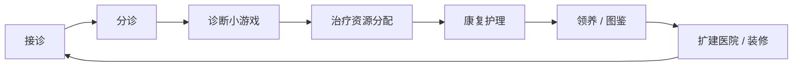
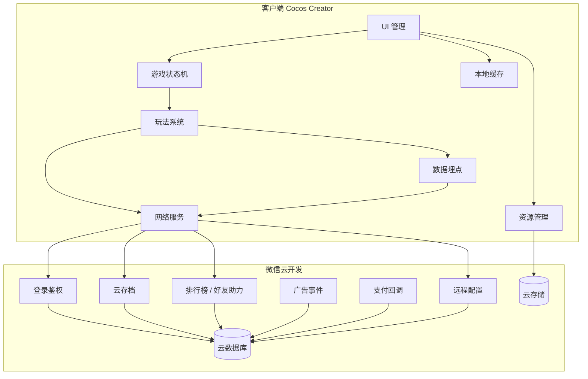
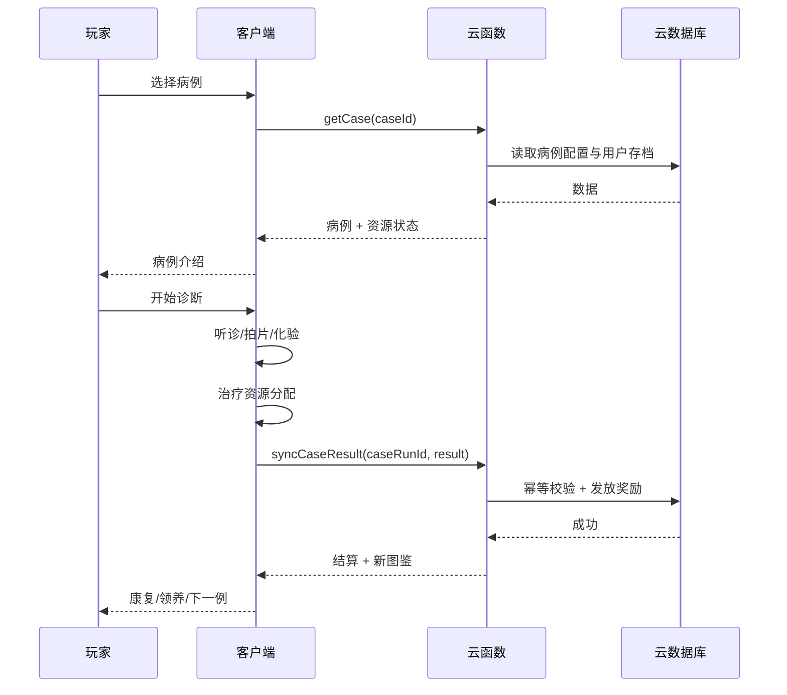
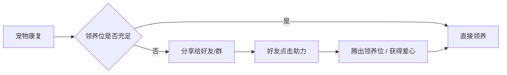
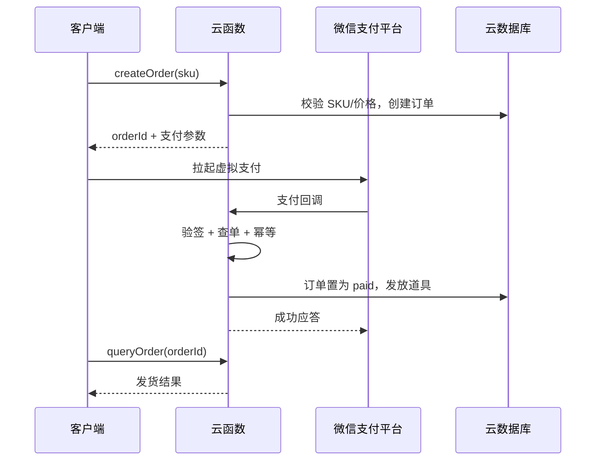

# 项目开发计划与系统框架设计

**项目：** 治愈系宠物医院 / 救助经营  
**平台：** 微信小游戏  
**技术栈：** Cocos Creator + 微信云开发  
**变现结构：** IAA 60% + IAP 40%  
**团队规模：** 4-6 人  
**开发周期：** 12 周（另留 2-4 周风险缓冲）  
**版本：** v1.0  
**日期：** 2026-10-29

> **说明**  
> 当前仓库只有《微信小游戏赛道可行性分析报告》，尚无 Cocos 工程与云开发代码。本文是规划态设计，类名、集合名、接口均为建议，落地时以实际工程为准；不要把本文当成已实现代码说明。

---

## 目录

- [1. 项目概述与开发目标](#1-项目概述与开发目标)
- [2. 系统架构](#2-系统架构)
  - [2.1 总体架构](#21-总体架构)
  - [2.2 客户端架构（Cocos Creator）](#22-客户端架构cocos-creator)
  - [2.3 服务端架构（微信云开发）](#23-服务端架构微信云开发)
  - [2.4 数据结构与云存档](#24-数据结构与云存档)
- [3. 核心玩法系统](#3-核心玩法系统)
  - [3.1 单局流程](#31-单局流程)
  - [3.2 诊断小游戏系统](#32-诊断小游戏系统)
  - [3.3 治疗资源分配系统](#33-治疗资源分配系统)
  - [3.4 领养、图鉴与社交裂变](#34-领养图鉴与社交裂变)
  - [3.5 长线经营](#35-长线经营)
- [4. 商业化系统](#4-商业化系统)
  - [4.1 IAA 广告接入](#41-iaa-广告接入)
  - [4.2 IAP 内购与定价](#42-iap-内购与定价)
  - [4.3 混合变现模型](#43-混合变现模型)
- [5. 开发计划与里程碑](#5-开发计划与里程碑)
- [6. 性能优化与发布](#6-性能优化与发布)
- [7. 美术风格与资产规范](#7-美术风格与资产规范)
- [8. 合规、风险与上线检查](#8-合规风险与上线检查)
- [9. 附录：指标口径](#9-附录指标口径)

---

## 1. 项目概述与开发目标

### 1.1 产品定位

玩家扮演宠物医院院长兼医生，通过接诊、诊断、治疗、康复、领养和医院扩建，完成从“救治一只动物”到“经营一家救助型医院”的长线目标。

产品不是传统“宠物店 / 动物餐厅”的换皮，而是把经营对象从“商品交易”换成“生命救治”：每个病例是一个 3-5 分钟的单局故事，医院扩建、病例图鉴、领养关系构成长线追求。

### 1.2 目标用户

- **核心用户：** 宠物兴趣人群、女性休闲用户、IAA 轻度用户。
- **不窄化为“女性向”：** 宠物医院对男性与家庭用户同样成立；投放素材可以偏治愈，但玩法不要做成纯换装。
- **用户习惯：** 单手、竖屏、3-8 分钟碎片时间；IAA 用户月均玩 7.5 款，忠诚度低，首局必须快速给出情绪回报。

### 1.3 市场依据

- 微信小游戏月活 5 亿+，IAA 用户约 4 亿，其中 70% 只玩休闲游戏，女性占 60%。
- 模拟经营 IAP 年增速 210%；放置、塔防、卡牌、MMO 规模 3-5 亿，付费用户约 1000-2000 万。
- 轻休闲在投产品超 1.5 万款，纯农场/餐厅/城建投放收缩，传统热门品类供给过剩。
- 2026-08 微信小游戏畅销 Top10 无纯宠物医院；《动物餐厅》是动物餐厅经营、《猫咪公寓》是猫咪收集装扮，属于相邻替代而非直接竞品。
- “宠物医院游戏”“宠物医生游戏”“养猫游戏”“救助流浪猫”均为明确搜索词；仍需用微信搜一搜指数与 DataEye 全量榜单复核。

### 1.4 核心循环



- **单局：** 接诊 → 分诊 → 听诊/拍片/化验 → 用药/床位/时间分配 → 结算，控制在 3-5 分钟。
- **长线：** 病例图鉴、动物好感度、医生团队、医院等级、领养故事、季节活动。
- **社交：** 好友助力救治、领养分享、医院参观、救助站排行。

### 1.5 MVP 边界

**必做：**

- 1 家医院、3 个诊室、12-15 个高质量病例、20 个品种。
- 3 个诊断小游戏：听诊（点击找病灶）、拍片（拖拽/比对）、化验（简单连线或匹配）。
- 药品、床位、时间三类资源的轻策略分配。
- 图鉴、领养条件、好友助力/分享、50 个装饰、7 日留存活动。
- 激励视频 + 月卡/装饰/专家/领养证书的内购骨架。

**暂不做：**

- 实时多人、跨服战、公会战。
- 复杂剧情树、全语音、长过场动画。
- 重度 SLG 式数值、装备强化、抽卡保底体系。
- 写实医疗、手术细节、血腥或虐待动物表现。
- UGC 关卡编辑器、宠物繁育等长周期系统。

### 1.6 团队、周期与技术栈

| 项目 | 规划 |
|---|---|
| 团队 | 4-6 人：制作/策划 1、程序 2、美术 2、运营/买量 1（可兼） |
| 周期 | 12 周（3 个月），另留 2-4 周风险缓冲 |
| 客户端 | Cocos Creator，竖屏，单手操作 |
| 服务端 | 微信云开发（云函数 + 云数据库 + 云存储） |
| 美术 | 2D 卡通/绘本风，治愈、温暖、明亮、柔和粉彩 |

### 1.7 商业化目标

- **结构：** IAA 60% + IAP 40%。
- **IAA：** 激励视频用于加速康复、额外检查、复活、双倍爱心、免费领养位；单日 6-10 次，插屏只放在病例结算后。
- **IAP：** 月卡、装饰皮肤、专家医生、领养证书、救助基金/战令；不做“付费才能救活”的强制卡点。
- **经济目标：** ARPDAU ≥0.5 元，LTV/CPA ≥1.2，CPA 控制在 1.5 元以内。

### 1.8 成功指标

| 指标 | 目标 |
|---|---|
| D1 留存 | ≥35% |
| D7 留存 | ≥12% |
| D30 留存 | ≥5% |
| 单局时长 | 3-5 分钟 |
| 人均日激励视频 | 6-10 次 |
| 分享率 | ≥8% |
| 好友助力率 | ≥15% |
| CPI | ≤1.5 元 |

---

## 2. 系统架构

### 2.1 总体架构



**架构原则：**

1. **服务端权威：** 货币、道具、广告奖励、订单、领养状态以服务端为准，客户端只做展示与预判。
2. **弱网可玩：** 单局诊断与治疗可以本地完成，结算时同步；同步失败进入重试队列，不丢奖励。
3. **配置外置：** 病例、价格、广告位、活动参数走远程配置，避免每次改数值都发版。
4. **最小依赖：** MVP 不引入复杂微服务、消息队列、实时对战；云函数 + 云数据库足够。

### 2.2 客户端架构（Cocos Creator）

| 模块 | 职责 | 关键接口（建议） | 常见坑 |
|---|---|---|---|
| UI 管理 | 页面栈、弹窗队列、层级、安全区适配 | `UIManager.open(page, data)` / `close(page)` | 弹窗叠加、返回键、刘海屏安全区 |
| 游戏状态机 | 启动、大厅、病例、治疗、领养、结算 | `GameFSM.change(state, payload)` | 状态未清理导致重复结算 |
| 动画控制 | Spine、Tween、UI 动效、宠物反馈 | `AnimController.play(unit, clip)` | 动画事件与逻辑不同步 |
| 网络服务 | 云函数调用、超时、重试、错误码 | `Net.call(name, data, options)` | 重复请求、弱网超时、并发覆盖 |
| 本地缓存 | 设置、引导、最近病例、临时存档 | `Cache.get/set(key, value, ttl)` | 版本升级后字段不兼容 |
| 资源管理 | Bundle、图集、预加载、释放 | `Res.loadBundle(name)` / `Res.release(tag)` | 资源泄漏、重复加载、内存峰值 |
| 事件总线 | 模块解耦、跨系统通知 | `EventBus.emit/on/off` | 监听未移除导致泄漏 |
| 数据埋点 | 漏斗、留存、广告、支付、分享 | `Track.log(event, props)` | 事件命名不一致、重复上报 |

**页面栈建议：**

```text
Boot → Lobby → CaseIntro → Diagnosis → Treatment → Recovery → Adoption → Result → Lobby
```

- `Boot`：初始化 SDK、云开发、远程配置、本地存档。
- `Lobby`：医院主界面、病例列表、图鉴、商城、任务。
- `CaseIntro`：病例故事、症状、目标、资源预览。
- `Diagnosis`：听诊/拍片/化验三选一或组合。
- `Treatment`：药品、床位、时间分配。
- `Recovery`：康复护理、好感度、广告加速。
- `Adoption`：领养条件、分享/助力、证书。
- `Result`：评分、奖励、下一例。

**状态机伪代码：**

```ts
type GameState = 'Boot' | 'Lobby' | 'CaseIntro' | 'Diagnosis' | 'Treatment' | 'Recovery' | 'Adoption' | 'Result';

class GameFSM {
  private state: GameState = 'Boot';

  change(next: GameState, payload?: unknown) {
    if (!this.canTransition(this.state, next)) return;
    this.onExit(this.state);
    this.state = next;
    this.onEnter(next, payload);
  }

  private canTransition(from: GameState, to: GameState): boolean {
    // 只允许白名单跳转，防止重复结算与非法回跳
    return true;
  }

  private onEnter(state: GameState, payload?: unknown) {
    // 打开对应页面、加载资源、注册事件
  }

  private onExit(state: GameState) {
    // 清理计时器、动画、事件监听、临时对象
  }
}
```

### 2.3 服务端架构（微信云开发）

| 云函数/模块 | 职责 | 关键点 |
|---|---|---|
| `login` | 获取 openid、初始化用户、返回云存档版本 | 不信任客户端传入的 openid；从云函数上下文取 |
| `getProfile` | 读取用户、医院、图鉴、任务 | 只返回当前用户数据 |
| `saveGame` | 写入医院经营数据、病例进度 | 版本号 + 乐观锁，防止多端覆盖 |
| `syncCaseResult` | 结算病例奖励、图鉴、好感度 | 幂等键 `caseRunId`，防重复领奖 |
| `leaderboard` | 好友榜、周榜、救助榜 | 分页、缓存、防刷 |
| `assist` | 好友助力、领养位、爱心奖励 | 每日次数限制、幂等、防互刷 |
| `adEvent` | 记录广告观看事件、发放奖励 | 客户端 `isEnded` + 服务端频控；以平台报表对账 |
| `createOrder` | 创建内购订单 | SKU 校验、价格服务端配置、防篡改 |
| `payCallback` | 支付回调、发货、对账 | 验签、幂等、订单状态机、退款处理 |
| `getConfig` | 病例、价格、活动、广告位配置 | 版本化、灰度、缓存 |

**云存档策略：**

- 客户端本地缓存 + 云端快照双写；云端为权威。
- 每次写存档带 `saveVersion`，服务端比较版本，冲突时以服务端为准并返回最新快照。
- 存档结构按版本迁移：`v1 -> v2` 的字段补默认值，不删除旧字段，直到确认无回滚需求。
- 关键操作（领奖、购买、领养）独立记录流水，不依赖存档覆盖。

**支付与广告回调原则：**

- 支付：创建订单 → 客户端拉起支付 → 平台回调 → 服务端验签/查单 → 发货 → 记录流水；重复回调按 `orderId` 幂等。
- 广告：客户端 `onClose` 只作为触发；服务端按用户、广告位、场景做频控与发放；定期用平台报表对账。
- iOS/Android 的虚拟支付政策不同，内购入口需按微信小游戏最新政策做平台判断；不确认的入口宁可先关闭，也不要违规上线。

### 2.4 数据结构与云存档

> 以下是建议结构，集合名与字段落地时可调整；所有金额以“分”为单位，避免浮点误差。

#### users

| 字段 | 类型 | 说明 |
|---|---|---|
| `_id` | string | 用户 ID |
| `openid` | string | 微信 openid，服务端写入 |
| `nickname` | string | 昵称，需授权 |
| `avatar` | string | 头像 URL |
| `level` | number | 院长等级 |
| `coins` | number | 金币 |
| `hearts` | number | 爱心/体力 |
| `saveVersion` | number | 存档版本 |
| `createdAt` | date | 创建时间 |
| `lastLoginAt` | date | 最近登录 |

#### pets_cases

| 字段 | 类型 | 说明 |
|---|---|---|
| `caseId` | string | 病例 ID |
| `petType` | string | 猫/狗/兔/鸟等 |
| `breed` | string | 品种 |
| `symptoms` | array | 症状标签 |
| `diagnosisType` | string | auscultation/xray/lab |
| `difficulty` | number | 1-5 |
| `rewards` | object | 金币、爱心、图鉴碎片 |
| `unlockLevel` | number | 解锁等级 |
| `story` | string | 病例短故事 |

#### hospital_state

| 字段 | 类型 | 说明 |
|---|---|---|
| `userId` | string | 用户 ID |
| `rooms` | array | 诊室/手术室/住院部 |
| `beds` | number | 床位数量 |
| `equipment` | object | 听诊器、X光、化验仪等级 |
| `staff` | array | 医生/护士 |
| `decorations` | array | 装饰 ID |
| `reputation` | number | 口碑/声望 |
| `updatedAt` | date | 更新时间 |

#### adoptions

| 字段 | 类型 | 说明 |
|---|---|---|
| `adoptionId` | string | 领养记录 ID |
| `userId` | string | 用户 ID |
| `petId` | string | 宠物 ID |
| `affection` | number | 好感度 |
| `status` | string | treating/recovered/adopted |
| `shared` | boolean | 是否分享过 |
| `createdAt` | date | 创建时间 |

#### ad_events

| 字段 | 类型 | 说明 |
|---|---|---|
| `eventId` | string | 事件 ID |
| `userId` | string | 用户 ID |
| `adUnitId` | string | 广告位 |
| `scene` | string | revive/accelerate/double/extra_check |
| `reward` | object | 发放内容 |
| `isEnded` | boolean | 是否看完 |
| `idempotencyKey` | string | 幂等键 |
| `createdAt` | date | 创建时间 |

#### orders

| 字段 | 类型 | 说明 |
|---|---|---|
| `orderId` | string | 内部订单号 |
| `userId` | string | 用户 ID |
| `sku` | string | 商品 ID |
| `amount` | number | 金额（分） |
| `status` | string | created/paid/delivered/refunded |
| `midasOrderId` | string | 平台订单号 |
| `createdAt` | date | 创建时间 |
| `paidAt` | date | 支付时间 |

#### config

| 字段 | 类型 | 说明 |
|---|---|---|
| `key` | string | 配置键 |
| `value` | object | 配置值 |
| `version` | number | 版本 |
| `updatedAt` | date | 更新时间 |

**索引建议：**

- `users.openid` 唯一索引。
- `adoptions.userId + status` 组合索引。
- `ad_events.idempotencyKey` 唯一索引。
- `orders.orderId` 唯一索引；`orders.midasOrderId` 唯一索引。
- `pets_cases.unlockLevel` 普通索引。

**数据保留：**

- 订单与支付流水长期保留；广告事件保留 90-180 天；行为埋点按分析需求保留。
- 用户注销/删除请求按隐私政策处理，保留必要的交易记录。

---

## 3. 核心玩法系统

### 3.1 单局流程



**单局时长控制：**

| 阶段 | 目标时长 | 说明 |
|---|---|---|
| 病例介绍 | 10-20 秒 | 一句话故事 + 症状 |
| 诊断 | 60-120 秒 | 1-2 个诊断小游戏 |
| 治疗分配 | 30-60 秒 | 药品/床位/时间 |
| 康复结算 | 15-30 秒 | 评分、奖励、好感度 |
| 领养/分享 | 15-30 秒 | 可选，不强制 |

### 3.2 诊断小游戏系统

#### 3.2.1 设计原则

- 只做点击、拖拽、简单连线；不做三消、重度解谜、长教程。
- 每个小游戏 20-40 秒，一局病例最多组合 2 个，避免疲劳。
- 失败要给出明确反馈（“这里没有异常，再听听右下腹”），不要纯惩罚。
- 失败后提供三条路：重试、看广告获得额外线索、消耗道具跳过；不能强制付费。

#### 3.2.2 听诊（点击找病灶）

**操作：** 宠物身体上有若干可点击区域，玩家点击寻找异常心音/呼吸音；正确区域有音效与视觉反馈，错误区域扣时间或增加误诊值。

**判定：**

```text
startAuscultation(caseData):
  spots = caseData.abnormalSpots        // 2-4 个异常点
  found = []
  mistakes = 0
  timeLeft = 30s

  onTap(spot):
    if spot in found:
      return
    if spot in spots:
      found.add(spot)
      playHeartbeat(spot)
      showHint("发现异常")
    else:
      mistakes += 1
      timeLeft -= 3s
      showHint("这里没有明显异常")

  if found.size == spots.size:
    return score(timeLeft, mistakes)    // 1-3 星
  if timeLeft <= 0:
    return fail("再试一次")
```

**难度曲线：**

| 难度 | 异常点 | 干扰点 | 时间 | 解锁 |
|---|---|---|---|---|
| 1 | 2 | 2 | 30s | 第 1 天 |
| 2 | 3 | 4 | 28s | 第 3 天 |
| 3 | 4 | 6 | 25s | 第 7 天 |

#### 3.2.3 拍片（拖拽/比对）

**操作：** 给出一张卡通 X 光片，玩家拖拽放大镜/标记框到异常位置；或者把两张片子拖到对比区，找出骨折/异物。

**判定：**

```text
startXray(caseData):
  target = caseData.lesionArea          // 矩形/圆形区域
  marker = spawnMarker()
  timeLeft = 25s

  onDragEnd(marker):
    if distance(marker, target) <= tolerance:
      return score(timeLeft, 0)
    else:
      showHint("再对比一下左右两侧")
      timeLeft -= 5s

  if timeLeft <= 0:
    return fail("可以看广告获得一次提示")
```

**注意：** X 光片用卡通化表现，不做真实医学影像；避免让用户误以为可以用于真实诊断。

#### 3.2.4 化验（简单连线/匹配）

**操作：** 左侧是样本（血液/尿液/皮肤刮片），右侧是试剂/指标；玩家把样本拖到正确试剂，或把颜色/数值连到对应结论。

**判定：**

```text
startLab(caseData):
  pairs = caseData.sampleReagentPairs   // 3-4 对
  matched = []
  mistakes = 0

  onConnect(sample, reagent):
    if pair(sample, reagent) in pairs:
      matched.add(pair)
      playSuccess()
    else:
      mistakes += 1
      showHint("这个试剂不匹配")

  if matched.size == pairs.size:
    return score(0, mistakes)
  if mistakes >= 3:
    return fail("再试一次")
```

#### 3.2.5 诊断评分

| 结果 | 条件 | 奖励 |
|---|---|---|
| 3 星 | 全对 + 用时 <70% + 误诊 0 | 全额金币 + 图鉴碎片 + 好感度 |
| 2 星 | 全对 + 误诊 ≤1 | 80% 金币 + 好感度 |
| 1 星 | 完成但误诊 ≥2 | 50% 金币 |
| 失败 | 超时/误诊过多 | 无金币，可重试/看广告 |

### 3.3 治疗资源分配系统

#### 3.3.1 资源类型

| 资源 | 产出 | 消耗 | 设计目的 |
|---|---|---|---|
| 药品 | 每日补给、任务、广告 | 每个病例按症状消耗 | 让玩家做“用对药”的选择 |
| 床位 | 医院等级、装饰、扩建 | 住院病例占用 | 制造轻排队与优先级 |
| 时间 | 医生班次、加速 | 诊断/治疗/康复 | 控制节奏，提供广告加速点 |
| 爱心 | 分享、助力、任务 | 领养、特殊治疗 | 社交与付费的软货币 |
| 金币 | 病例结算、任务 | 扩建、装饰、道具 | 长线经营的主货币 |

#### 3.3.2 分诊与优先级

- 每个病例有“危急度”：普通、紧急、危重。
- 危重病例如果等待过久，会掉好感度/口碑，但不会“死亡”造成强负反馈；用“病情加重、治疗难度上升”替代。
- 玩家需要决定先治谁、给谁床位、用哪种药；资源不足时可以通过广告、好友助力、道具补足。

#### 3.3.3 分配伪代码

```text
startTreatment(caseData, inventory):
  required = caseData.requiredMedicine
  availableBeds = inventory.beds - occupiedBeds

  if inventory.medicine[required] <= 0:
    return fail("缺少对症药品", offer: [ad, friendAssist, shop])

  if availableBeds <= 0 and caseData.needsBed:
    return fail("床位不足", offer: [ad, friendAssist, expand])

  applyMedicine(required)
  if caseData.needsBed:
    occupyBed(caseData)

  healing = baseHealing
    + medicineMatchBonus
    + equipmentBonus
    + staffBonus
    - delayPenalty

  if healing >= caseData.cureThreshold:
    return success(score(healing))
  else:
    return partial("病情稳定，但需要继续护理")
```

#### 3.3.4 轻策略边界

- 一局最多 3-5 个决策点，不做复杂排班表。
- 资源数值不超过 5 种，避免认知负担。
- 失败可恢复：重试、广告、好友助力，不让玩家卡死。
- 不做“资源不足只能付费”的死锁；始终保留广告/社交/等待三条免费路径。

### 3.4 领养、图鉴与社交裂变

#### 3.4.1 好感度

- 来源：成功治疗、康复护理、喂食、玩耍、分享、好友助力。
- 等级：陌生 → 亲近 → 信任 → 家人；每级解锁一段小故事/表情/装饰。
- 好感度不影响“能否救治”，只影响领养资格与图鉴奖励，避免情感绑架。

#### 3.4.2 领养条件

领养一只康复宠物，需要满足以下条件中的若干项：

| 条件 | 说明 | 免费替代 |
|---|---|---|
| 治疗完成 | 病例达到康复 | 必须 |
| 好感度 ≥ 阈值 | 通过护理/互动提升 | 必须 |
| 领养位 | 医院有空的领养位 | 分享/好友助力/扩建 |
| 领养证书 | 可选装饰/纪念 | 看广告/金币/内购 |

**原则：** 分享和广告是“加速”，不是“唯一路径”；必须保留金币/等待/任务等免费替代，符合微信分享规范。

#### 3.4.3 图鉴

- 每个品种一张卡：立绘、名字、故事、救助日期、好感度、领养状态。
- 收集奖励：金币、装饰、医生经验、限定病例。
- 图鉴是长线目标，也是买量素材与社区传播的素材库。

#### 3.4.4 社交裂变



**分享设计：**

- 分享文案： “这只流浪猫已经康复了，医院床位不够，帮我给它找个家。”
- 好友点击后：助力 +1，双方获得少量爱心；每日上限 3-5 次。
- 防刷：同一好友每日只算一次；新用户助力权重更高；异常频率进风控。
- 合规：分享按钮由用户主动点击；不得“不分享就不能领养”；不得诱导分享到群。

#### 3.4.5 社交指标

| 指标 | 目标 | 口径 |
|---|---|---|
| 分享率 | ≥8% | 分享人数 / 领养触发人数 |
| 助力率 | ≥15% | 助力人数 / 分享触达人数 |
| 好友回流 | ≥5% | 助力后 7 日内登录 |
| 领养完成率 | ≥60% | 完成领养 / 进入领养页 |

### 3.5 长线经营

- **医院扩建：** 诊室、手术室、住院部、领养区；每级解锁新病例/新设备。
- **医生团队：** 院长、主治、护士；影响诊断提示、治疗加成、排队效率。
- **口碑：** 成功救治、领养、分享提升；延误、失败下降；口碑影响病例质量与客流。
- **季节活动：** 春季流浪猫、夏季中暑、冬季保暖；活动病例与限定装饰。
- **数值节奏：** 前 7 天每天解锁 2-3 个新病例；第 2 周进入日常循环；第 4 周开放领养区扩建。

---

## 4. 商业化系统

### 4.1 IAA 广告接入

#### 4.1.1 广告类型与位置

| 广告类型 | 触发场景 | 奖励 | 频控 |
|---|---|---|---|
| 激励视频 | 诊断失败复活 | 一次重试/额外线索 | 每局 1 次 |
| 激励视频 | 治疗加速 | 缩短 50% 康复时间 | 每病例 1 次 |
| 激励视频 | 双倍奖励 | 病例结算金币 ×2 | 每日 5 次 |
| 激励视频 | 额外检查 | 增加一个诊断线索 | 每病例 1 次 |
| 激励视频 | 免费领养位 | 临时腾出一个领养位 | 每日 3 次 |
| 插屏 | 病例结算后 | 无 | 每 2-3 局 1 次，频控 |
| Banner | 大厅/商城底部 | 无 | 常驻，避免遮挡 |

#### 4.1.2 接入伪代码

```ts
const rewarded = wx.createRewardedVideoAd({ adUnitId: AD_UNIT_REVIVE });

rewarded.onClose((res) => {
  if (res && res.isEnded) {
    grantReward('revive');
  } else {
    toast('完整观看才能获得奖励');
  }
});

function showRewarded(scene: string) {
  if (!canShowAd(scene)) return;
  rewarded.show().catch(() => {
    rewarded.load().then(() => rewarded.show());
  });
}
```

#### 4.1.3 频控与体验

- 单日激励视频上限 6-10 次；超过后不再提示，避免广告疲劳。
- 插屏只在病例结算后，不在诊断/治疗中途弹出。
- 广告加载失败要有兜底：直接给少量奖励或提示“稍后再试”，不能卡住流程。
- 记录 `scene`、`adUnitId`、`isEnded`、`reward`，用于分析 eCPM 与留存关系。
- 广告回调以服务端记录 + 平台报表对账；客户端只做即时反馈。

### 4.2 IAP 内购与定价

#### 4.2.1 SKU 设计

| SKU | 价格 | 内容 | 定位 |
|---|---|---|---|
| 月卡 | 30 元 | 每日 100 爱心 + 1 张加速券 + 专属头像框 | 复购基本盘 |
| 周卡 | 6 元 | 每日 30 爱心 + 1 次免费检查 | 低门槛首付 |
| 装饰包·森林诊所 | 30 元 | 主题墙面/地板/家具 | 女性向审美付费 |
| 装饰包·海边救助站 | 68 元 | 限定主题 + 宠物服饰 | 中额付费 |
| 专家医生·外科 | 68 元 | 治疗加成 + 专属病例 | 功能+收集 |
| 领养证书·定制 | 30 元 | 证书外观 + 图鉴展示 | 情感付费 |
| 救助基金/战令 | 68 元 | 赛季任务 + 限定装饰 + 头像框 | 长线活跃 |
| 爱心礼包 | 6/30/68 元 | 爱心 + 金币 | 应急补给 |

#### 4.2.2 定价原则

- 首付 6 元，主力 30 元，中额 68 元，避免一上来 128/328 元的高门槛。
- 不做“付费才能救活”；内购只加速、装饰、收集、便利。
- 不做付费随机抽宠物，避免赌博/合规风险；如需随机，使用免费广告抽卡并公示概率。
- 月卡/战令的每日奖励要可预期，避免“付费打工”感。

#### 4.2.3 支付流程



**注意：**

- 微信小游戏内购使用虚拟支付能力，iOS/Android 政策不同；上线前按最新官方文档确认入口与可用性。
- 价格以服务端配置为准，客户端只展示；防止篡改金额。
- 支付回调必须验签、查单、幂等；重复回调不重复发货。
- 退款/补单要有后台工具与对账流程。

### 4.3 混合变现模型

**目标结构：IAA 60% + IAP 40%。**

| 指标 | 保守 | 目标 | 乐观 |
|---|---|---|---|
| DAU | 5 万 | 10 万 | 30 万 |
| 人均日激励视频 | 5 次 | 7 次 | 9 次 |
| 激励视频 eCPM | 40 元 | 55 元 | 70 元 |
| IAA ARPDAU | 0.20 元 | 0.35 元 | 0.55 元 |
| IAP ARPDAU | 0.10 元 | 0.20 元 | 0.35 元 |
| 综合 ARPDAU | 0.30 元 | 0.55 元 | 0.90 元 |
| CPA | 1.2 元 | 1.5 元 | 2.0 元 |
| 30 日 LTV/CPA | 0.8 | 1.2 | 1.8 |

**敏感性：** 如果 CPA 从 1.5 元涨到 2.5 元，而 ARPDAU 仍为 0.5 元，回本周期会从约 3 天拉长到 5 天以上；若 D7 <10%，IAA 模型基本不成立。必须用混合变现与自然量对冲。

---

## 5. 开发计划与里程碑

### 5.1 12 周 WBS

| 周次 | 目标 | 交付物 | 负责角色 | 验收标准 |
|---|---|---|---|---|
| 第 1 周 | 工程与框架 | Cocos 工程、云开发环境、UI 框架、状态机、存档结构、埋点规范 | 主程 + 客户端 | 能在真机跑通 Boot→Lobby |
| 第 2 周 | 单局原型 | 1 个病例、听诊小游戏、治疗分配、结算 | 客户端 + 策划 | 3-5 分钟完成一局 |
| 第 3 周 | 诊断扩展 | 拍片、化验、3 个病例、难度曲线 | 客户端 + 美术 | 3 个病例可玩，无阻塞 |
| 第 4 周 | 单局闭环 | 康复、好感度、图鉴、失败/重试/广告占位 | 客户端 + 策划 | 单局闭环完整，D1 可测 |
| 第 5 周 | 长线经营 | 医院扩建、床位、医生、口碑、日常任务 | 客户端 + 服务端 | 存档可跨端同步 |
| 第 6 周 | 领养社交 | 领养条件、分享、好友助力、防刷 | 客户端 + 服务端 | 分享/助力链路跑通 |
| 第 7 周 | 内容扩充 | 12-15 个病例、20 个品种、50 个装饰 | 策划 + 美术 | 内容表配置化，无硬编码 |
| 第 8 周 | 数值与活动 | 7 日留存活动、赛季、经济回收 | 策划 + 服务端 | 7 日经济曲线可解释 |
| 第 9 周 | IAA 接入 | 激励视频、插屏、Banner、频控、埋点 | 客户端 + 服务端 | 广告奖励可对账 |
| 第 10 周 | IAP 接入 | 月卡、装饰、专家、证书、订单/回调 | 服务端 + 客户端 | 沙箱支付闭环 |
| 第 11 周 | 性能与合规 | 包体、首屏、内存、图集、Spine、审核材料 | 全组 | 低端机 30 FPS，内存 <300MB |
| 第 12 周 | 软测与上线 | 500-1000 人软测、数据复盘、上线包 | 全组 | 核心指标达标 |
| 第 13-14 周 | 缓冲 | 修 Bug、补内容、买量素材迭代 | 全组 | 可放量 |

### 5.2 角色分工

| 角色 | 主要职责 |
|---|---|
| 制作/策划 | 玩法、数值、病例内容、商业化、验收 |
| 客户端 | Cocos 框架、UI、玩法、性能、SDK 接入 |
| 服务端 | 云函数、数据库、支付/广告回调、风控 |
| 美术 | UI、角色、宠物、场景、Spine、买量素材 |
| 运营/买量 | 素材测试、投放、社区、数据复盘 |

### 5.3 里程碑验收

- **M1（第 4 周）：** 单局闭环可玩，3-5 分钟，无阻塞；D1 预测试 ≥30%。
- **M2（第 8 周）：** 长线经营与领养社交跑通；分享率 ≥5%（内测）。
- **M3（第 12 周）：** 商业化闭环，D1 ≥35%、D7 ≥12%、ARPDAU ≥0.5、LTV/CPA ≥1.2。
- **M4（第 14 周）：** 软测复盘，决定加码/降级/换方向。

---

## 6. 性能优化与发布

### 6.1 包体与首屏

| 项目 | 目标 | 手段 |
|---|---|---|
| 主包 | 尽量 <4MB（以微信最新限制为准） | 只放 Boot/Lobby/通用 UI；玩法与病例进分包 |
| 总分包 | 按平台上限规划 | 按章节/玩法拆分，按需加载 |
| 首屏加载 | 中端机 <3 秒 | 预加载关键图集、异步加载大厅、加载动画 |
| 纹理 | 控制显存 | 压缩纹理、图集合并、避免大图单独加载 |
| 音频 | 控制包体 | 压缩格式、按场景加载、限制同时播放通道 |

### 6.2 内存与渲染

- 目标内存 <300MB，低端机 <250MB 更安全。
- 图集合并：UI 按页面/主题合并，避免每张图一个材质。
- Spine：复用骨骼与图集，同一宠物不同皮肤共用骨架；控制同屏 Spine 数量。
- 对象池：病例卡、飘字、特效、列表项复用。
- 场景释放：离开诊断/治疗场景时释放临时纹理、音效、动画。
- Draw Call：UI 层级扁平化，避免频繁打断合批；文本使用缓存。
- 帧率：中端机 30 FPS 稳定，高端机可 60 FPS；不为特效牺牲稳定性。

### 6.3 真机测试矩阵

| 设备档位 | 示例 | 关注点 |
|---|---|---|
| 低端 Android | 4GB 内存/老 CPU | 首屏、内存、崩溃、发热 |
| 中端 Android | 6-8GB | 帧率、广告加载、支付 |
| iPhone 老机型 | iPhone 11/SE | 内存警告、WebGL 兼容 |
| iPhone 新机型 | iPhone 14/15 | 高刷、刘海安全区 |
| 微信开发者工具 | 最新稳定版 | 云函数、广告模拟、支付沙箱 |

### 6.4 发布检查

- [ ] 主包/分包大小符合平台限制。
- [ ] 首屏 <3 秒，弱网有加载提示。
- [ ] 低端机 30 FPS，内存 <300MB，无频繁 GC。
- [ ] 广告位 ID 正确，激励视频 `isEnded` 判断正确。
- [ ] 支付回调验签、幂等、补单、退款流程验证。
- [ ] 云存档跨端同步、版本迁移验证。
- [ ] 隐私政策、用户协议、未成年人保护、客服入口齐全。
- [ ] 审核素材、截图、描述、类目选择正确。

---

## 7. 美术风格与资产规范

### 7.1 风格定义

- **关键词：** 2D 卡通、绘本、治愈、温暖、明亮、柔和粉彩、圆角、留白。
- **禁止：** 写实医疗、血腥、手术细节、恐怖、虐待动物、过度悲惨。
- **色彩：** 主色浅绿/奶油白/暖黄；辅色淡粉/浅蓝；避免高饱和刺眼。
- **角色：** 女兽医亲和、圆润比例、浅绿色手术服；宠物表情丰富、不过度拟人化。
- **UI：** 圆角卡片、半透明面板、手绘图标、柔和阴影；保证文字可读性。

### 7.2 资产交付

| 资产 | 规格 |
|---|---|
| 主界面 | 1080×1920 设计稿，安全区适配 |
| 诊疗 HUD | 竖屏，左侧病历，右侧操作，底部资源条 |
| 图鉴卡 | 3:4，花卉边框，姓名/简介占位 |
| 角色 | 三视图 + 6 表情 + 关键动作 |
| 宠物 | 三视图 + 4 表情 + 生病/康复状态 |
| UI 图集 | 2048×2048，九宫格可拉伸 |
| Spine | 共用骨架，皮肤分离，控制骨骼数量 |
| 买量素材 | 9:16，救治前后对比，3 秒内出现冲突 |

### 7.3 Midjourney 提示词

> 以下提示词作为美术方向参考，不直接作为最终资产；生成后需统一角色比例、色彩与 UI 组件规范。

**1. 游戏主界面 Main Menu**

```text
Mobile game UI design, main menu interface for a "Healing Pet Hospital" simulation game, 2D cartoon style, cozy and warm color palette, pastel tones, cute and healing atmosphere, illustration of a cozy veterinary clinic reception area, lots of plants, soft sunlight from the window. Large "Start" button, top bar with hearts (currency) and settings icons, clean layout, vector art, UI/UX, Dribbble, Behance, high resolution, --ar 9:16 --v 6.0 --style raw
```

中文释义：治愈系宠物医院模拟游戏主菜单，2D 卡通，温馨柔和粉彩，诊所前台、绿植、窗外柔光，大号开始按钮，顶部爱心货币与设置图标，干净矢量 UI。

**2. 游戏内诊疗 HUD In-Game HUD**

```text
Mobile game HUD design, veterinary diagnosis gameplay screen, portrait orientation, 2D cartoon flat design. A cute sick puppy on an examination table in the center. Left side: patient medical chart UI. Right side: action buttons (Stethoscope, X-ray, Medicine). Bottom center: semi-transparent UI panel with a timer and heart resource bar. Soft glowing UI elements, rounded corners, warm pastel colors, clean vector graphics, game UI asset, --ar 9:16 --v 6.0
```

中文释义：竖屏兽医诊断 HUD，中央检查台上的生病小狗，左侧病历，右侧听诊器/X光/药品按钮，底部半透明计时器与爱心资源条，柔和发光、圆角、暖粉彩。

**3. 宠物图鉴/领养卡片 Collection Card**

```text
UI design for a mobile game collection card, showing a cute rescued kitten, 2D cartoon style, rich details, expressive eyes, surrounded by a beautiful floral frame. Text placeholder for name and bio at the bottom. Warm and healing aesthetic, soft lighting, storybook illustration style, high quality, isolated on a light warm background, --ar 3:4 --niji 6
```

中文释义：宠物图鉴/领养卡，被救助的小猫，2D 卡通，花卉边框，底部姓名与简介占位，温暖治愈、柔和光照、绘本插画风。

**4. 核心角色与宠物 Assets**

```text
Character design sheet for a mobile game, a young friendly female veterinarian wearing a light green scrub suit and holding a cute chubby cat, 2D cartoon vector art style, multiple poses and expressions, clean outlines, vibrant but soft colors, transparent background, game asset, sprite, --ar 16:9 --v 6.0
```

中文释义：角色设定图，年轻友好的女兽医，浅绿色手术服，抱着胖猫，多姿势表情，2D 卡通矢量，干净轮廓，柔和鲜艳，透明背景。

**5. 买量测试素材 Ad Creatives**

```text
Mobile game ad creative, split screen style, top half shows a dirty, sad stray puppy in the rain, bottom half shows the same puppy clean, happy, and playing in a warm sunny veterinary clinic. High emotional contrast, before and after, 2D cartoon style, healing aesthetic, high click-through rate design, bright colors, --ar 9:16
```

中文释义：买量素材，上下分屏，上半部雨中脏污悲伤的流浪狗，下半部同一只狗在温暖阳光的诊所干净快乐地玩耍；高情感对比、前后对比、2D 卡通、治愈美学。

### 7.4 资产验收

- [ ] 角色比例、线宽、阴影、圆角统一。
- [ ] UI 组件可九宫格拉伸，适配 16:9 / 19.5:9 / 20:9。
- [ ] 图集无重复资源，命名规范，分辨率不过度。
- [ ] Spine 骨骼复用，同屏数量受控。
- [ ] 宠物三视图/表情包齐全，方便动画拆件。
- [ ] 买量素材不渲染虐待、血腥、过度悲惨。

---

## 8. 合规、风险与上线检查

### 8.1 合规清单

| 项目 | 要求 |
|---|---|
| 游戏类目 | 按微信小游戏“休闲游戏”类目申报；不要选宠物医疗/生活服务类目 |
| 医疗表述 | 不提供真实诊断、处方、用药建议；游戏内明确“虚构医疗模拟” |
| 动物伦理 | 不表现虐待、遗弃、安乐死娱乐化；救助/领养叙事正向 |
| 未成年人 | 实名认证、防沉迷、支付限额、家长监护提示 |
| 隐私 | 隐私政策、用户协议、授权说明、数据删除入口 |
| 广告 | 广告内容合规、频控、可关闭、不诱导点击 |
| 分享 | 用户主动分享，不强制、不诱导群分享，保留免费替代 |
| 支付 | 虚拟支付合规、价格透明、订单可查、退款通道 |
| 内容 | 无血腥、恐怖、赌博、低俗；UGC 暂不开放 |
| 客服 | 在线客服/反馈入口、投诉处理流程 |

### 8.2 风险矩阵

| 风险 | 概率 | 影响 | 缓解 |
|---|---|---|---|
| 搜索量不足，用户搜不到 | 中 | 高 | 2 周搜索验证；产品名含“宠物医院/宠物医生”；小红书/抖音内容种草 |
| 买量成本上涨，IAA 不赚钱 | 高 | 高 | 混合变现；素材矩阵；自然量/社交裂变；软测后再放量 |
| 大厂/头部快速克隆 | 中 | 中 | 题材先发、美术风格、病例内容、社区领养故事 |
| 医疗/动物伦理审核 | 中 | 高 | 卡通化、避免真实诊疗、内部合规评审 |
| 美术产能不足 | 中 | 中 | 12-15 个病例起步；模块化；AI 仅做草稿/变体 |
| 支付政策变化 | 中 | 高 | 按最新政策做平台判断；保留纯 IAA 版本 |
| 分享被判定诱导 | 中 | 中 | 分享可选；免费替代；频率限制 |

### 8.3 上线检查

- [ ] 类目、资质、隐私政策、用户协议、客服入口。
- [ ] 实名/防沉迷/支付限额。
- [ ] 广告位、频控、激励视频回调。
- [ ] 支付回调、补单、退款、对账。
- [ ] 云存档迁移、跨端同步、异常恢复。
- [ ] 低端机性能、弱网、断线重连。
- [ ] 分享文案、图片、落地页合规。
- [ ] 买量素材审核：无虐待、无血腥、无虚假承诺。
- [ ] 数据埋点：留存、广告、支付、分享、助力。
- [ ] 客服与舆情预案。

---

## 9. 附录：指标口径

| 指标 | 定义 | 目标 |
|---|---|---|
| D1 留存 | 次日登录 / 新增 | ≥35% |
| D7 留存 | 第 7 日登录 / 新增 | ≥12% |
| D30 留存 | 第 30 日登录 / 新增 | ≥5% |
| CPA | 注册成本 | ≤1.5 元 |
| LTV | 用户生命周期收入 | LTV/CPA ≥1.2 |
| ARPDAU | 日收入 / DAU | ≥0.5 元 |
| eCPM | 千次广告展示收入 | 40-70 元 |
| 分享率 | 分享人数 / 领养触发人数 | ≥8% |
| 助力率 | 助力人数 / 分享触达人数 | ≥15% |
| 单局时长 | 接诊到结算 | 3-5 分钟 |
| 首屏时长 | 启动到可交互 | <3 秒 |
| 内存峰值 | 真机运行峰值 | <300MB |

---

## 10. 执行建议

1. **先验证，再扩内容。** 先做 1 个病例 + 1 个诊断小游戏 + 1 条买量素材，2 周内验证搜索、CPI、首局完成率；不要先做 30 个病例。
2. **先做单局，再做长线。** 单局不好玩，图鉴/领养/扩建都救不回来。
3. **先做 Android，再做 iOS 支付适配。** 虚拟支付政策不同，先用 IAA + Android 内购跑通模型。
4. **先做自然量，再做买量。** 分享/助力/社区是免费流量；买量只放大已验证的素材。
5. **任何两项核心指标不达标，就降级或换方向。** 不要用“再优化一下”拖延。

---

**参考资料**

- [微信小游戏赛道可行性分析报告.md](file:///C:/Users/MSI/Desktop/programe/new_game/微信小游戏赛道可行性分析报告.md)
- [.qoder/repowiki/wiki_plan.yaml](file:///C:/Users/MSI/Desktop/programe/new_game/.qoder/repowiki/wiki_plan.yaml)
